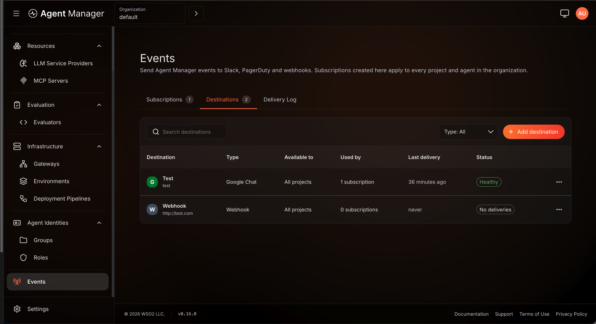
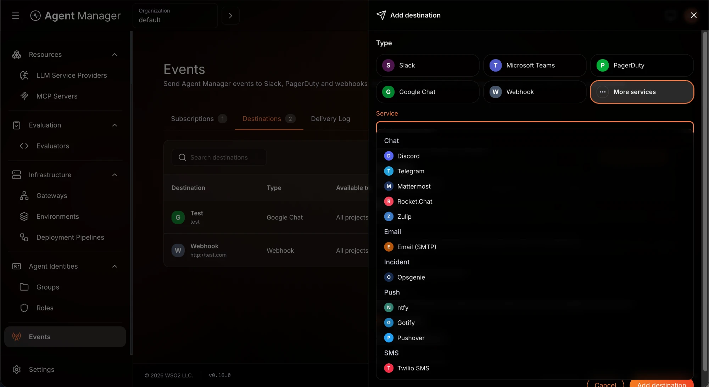
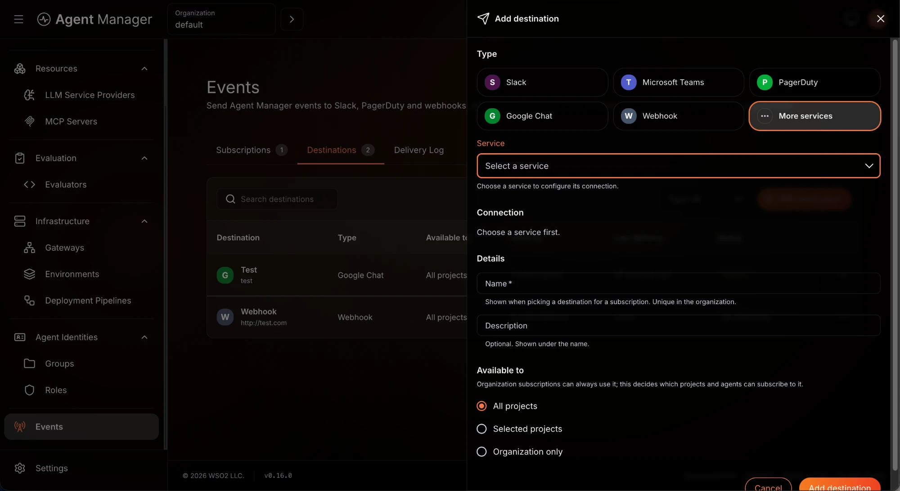
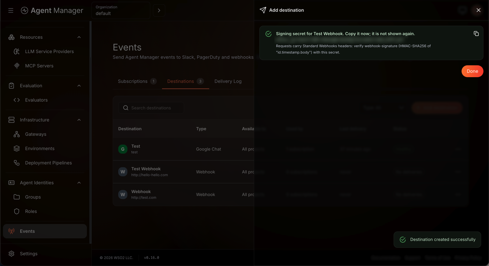
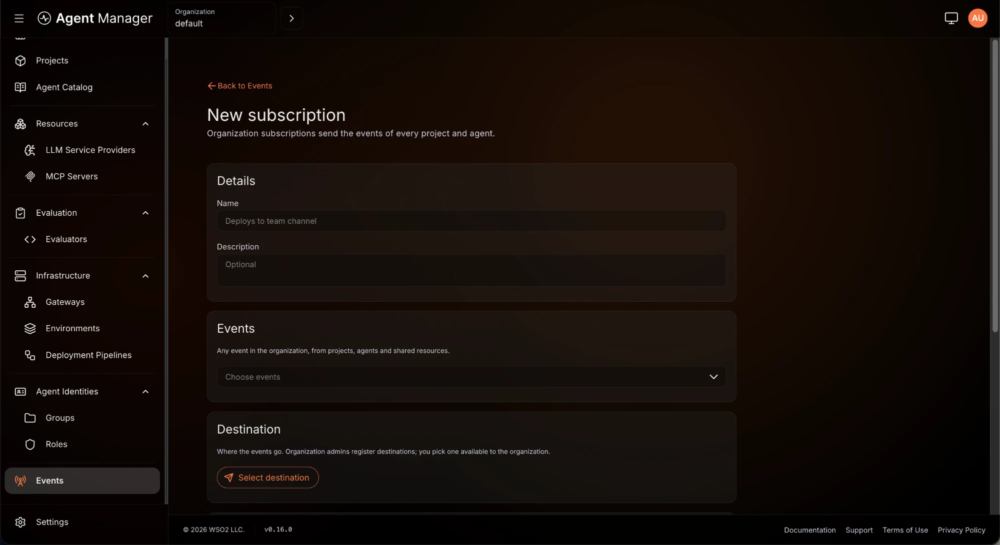
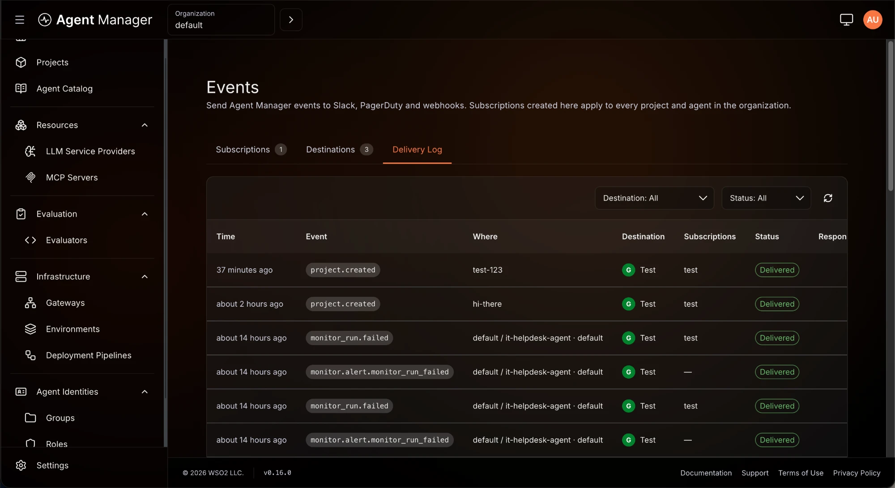

# Configure Event Alerts

Send WSO2 Agent Manager events to a webhook, chat channel, email recipient, or incident service. Register a destination, subscribe to events, and inspect delivery results in the Console.

:::info Unreleased Feature
Event alerts require an Agent Manager build containing the Events and monitor-alerting changes. These instructions describe the Next version.
:::

## Prerequisites

- An installation with eventing enabled, as described below.
- An organization role with `amp:events:manage` to create and test destinations. Viewing organization Events requires `amp:events:read`.
- A receiver endpoint or notification service credentials. See [Notification Service URLs](./notification-service-urls.mdx).

## Step 1: Enable Eventing

For Helm installations, eventing is **off by default**. Add this configuration to your installation values and apply it through your existing Helm upgrade process:

```yaml
agentManagerService:
  config:
    events:
      mode: nats
```

Without an external server URL, this configuration deploys the bundled NATS server with persistent JetStream storage. To use an existing JetStream server, configure its URL and, when required, its token Secret:

```yaml
agentManagerService:
  config:
    events:
      mode: nats
      natsUrl: nats://nats.example.com:4222
      natsToken:
        existingSecret: agent-manager-nats-auth
        existingSecretKey: token
```

Create the referenced Secret in the Agent Manager namespace before applying these values. Keep the token out of committed values files.

For deployments configured through environment variables, set `EVENTS_MODE=nats` and `EVENTS_NATS_URL`. Set `EVENTS_NATS_TOKEN` through your secret-management mechanism when the server requires it. With no mode or URL configured, the service defaults to `off`; supplying a URL without a mode selects `nats`.

Use `EVENTS_MODE=off`, or Helm `mode: "off"`, to disable event processing and alert delivery explicitly. The Console hides **Events** while eventing is disabled. Monitor evaluations continue running.

The quick-start installer explicitly selects `embedded` mode. Its in-memory bus supports one service replica and loses queued bus messages and pending bus retries on restart. Use `nats` for persistent delivery and multiple replicas.

## Step 2: Register a Destination



1. Select your organization in the Console and open **Events** in the sidebar.
2. Open **Destinations** and click **Add destination**.
3. Select the notification service, or select **Webhook** for a custom receiver. Use **More services** to find additional notification integrations.
4. Enter the service URL from [Notification Service URLs](./notification-service-urls.mdx), or the webhook **Endpoint URL**.
5. Enter a **Name** and optional **Description**.
6. Under **Available to**, select **All projects**, **Selected projects**, or **Organization only**. For selected projects, select the projects that may use the destination.
7. Click **Add destination**.





Notification URLs contain credentials. Agent Manager encrypts them and does not return them when a destination is read. When editing a destination, leave the URL empty to retain the saved credential.

For webhooks, copy the signing secret when it is displayed. Verify incoming requests using the `webhook-id`, `webhook-timestamp`, and `webhook-signature` headers according to [Standard Webhooks](https://www.standardwebhooks.com/). Use `webhook-id` to deduplicate deliveries.



## Step 3: Subscribe to Events

1. At the organization, project, or agent scope, open **Events** → **Subscriptions**.
2. Open the subscription creation form and enter its name.
3. Select a destination available to that scope.
4. Select the event types to receive and any environment filter.
5. Click **Create subscription**.



An organization subscription receives matching events from the organization and its projects and agents. A project subscription receives matching events from that project and its agents. An agent subscription receives matching events from that agent.

A subscription does not receive events from a wider scope. An empty environment filter includes all environments. Events without an environment also match an environment filter.

When several subscriptions match the same event and destination, Agent Manager sends one delivery and records all matching subscriptions. Inherited subscriptions appear read-only at narrower scopes.

## Verify Delivery

Use the destination's test action and confirm that the receiver gets the test notification. A test sends a real message; it does not require a subscription. Only callers with `amp:events:manage` can test destinations.

Trigger a subscribed event, then open **Delivery Log** at the corresponding scope. Inspect its status and any delivery error. Delivery is at least once, so receivers must tolerate duplicates.



Delivery history is retained for 14 days by default. Operators can change `EVENTS_DELIVERY_RETENTION_DAYS` and `EVENTS_DELIVERY_MAX_ATTEMPTS` (six attempts by default).

## Troubleshooting

- **Events is missing:** confirm eventing is enabled and your token contains the required permissions. The Console discovers the feature through `GET /api/v1/config`.
- **A destination is unavailable:** check **Available to** and the project selection. Project and agent subscriptions cannot use an organization-only destination.
- **A URL is rejected:** check the service URL syntax and percent-encoding. Production destinations must resolve to public addresses; private endpoints are blocked by default. `EVENTS_ALLOW_PRIVATE_DESTINATIONS=true` is intended for local development.
- **Deletion or an availability change is refused:** remove or update subscriptions and monitor alert rules that still use the destination before retrying.
- **A delivery fails:** check the provider credential, receiver availability, and delivery error. Webhook retries include network failures, rate limits, and server errors; most other client errors are terminal.

## Next Steps

- [Configure Monitor Alerts](./configure-monitor-alerts.mdx)
- [Notification Service URLs](./notification-service-urls.mdx)
