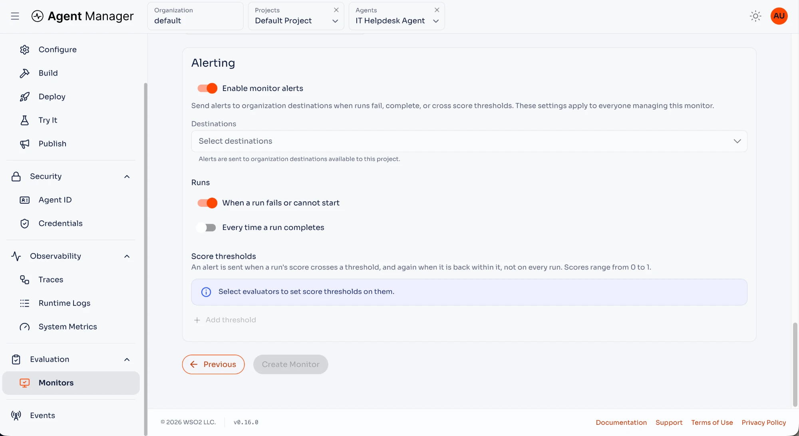
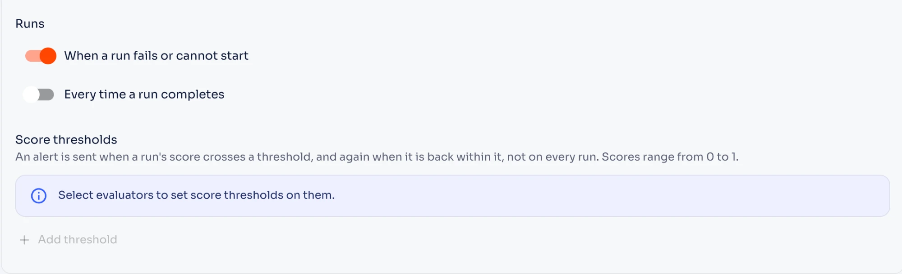
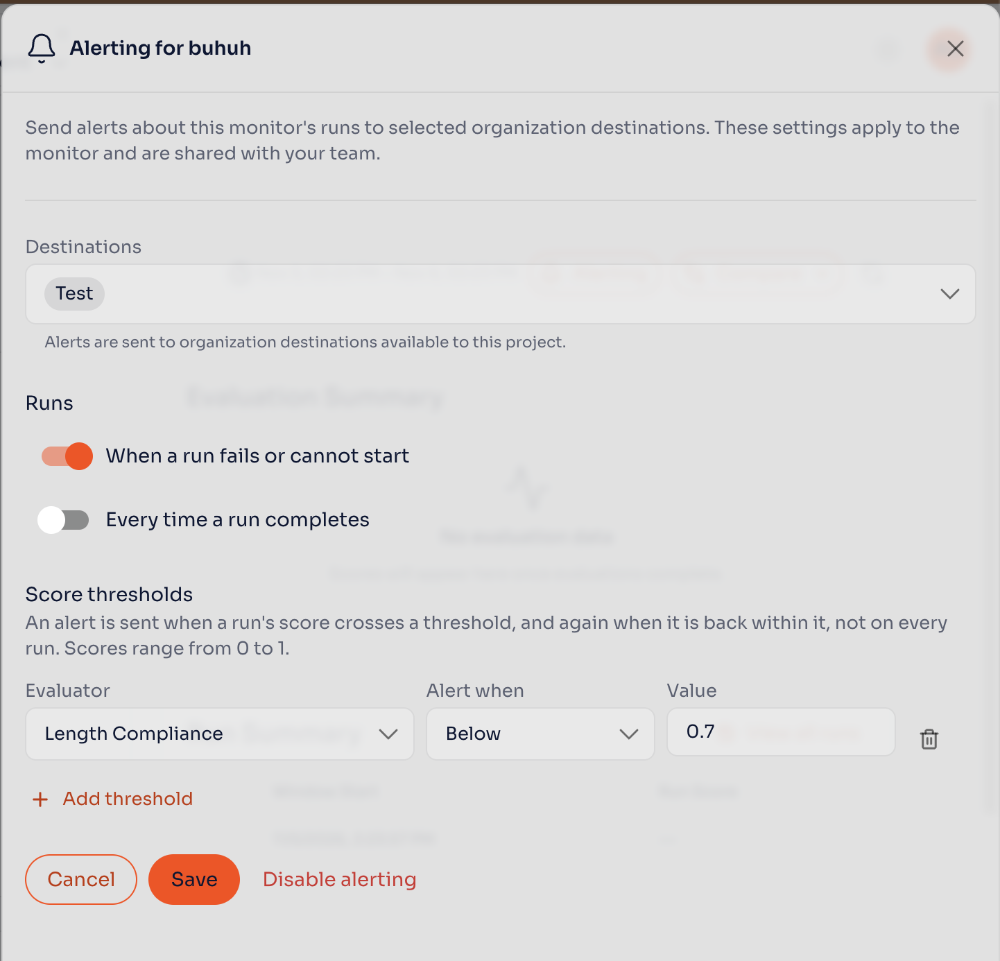

# Configure Monitor Alerts

Send WSO2 Agent Manager evaluation outcomes to shared organization destinations. Configure failure, completion, and score-threshold alerts for each monitor.

## Prerequisites

- An installation with [eventing enabled](./configure-event-alerts.mdx#step-1-enable-eventing).
- An [evaluation monitor](./evaluation-monitors.mdx) and at least one organization destination available to its project.
- `amp:monitor:read` to view settings and `amp:monitor:update` to change them.
- To verify an alert: `amp:monitor:execute` to run the monitor, and `amp:agent:read` to open the agent's **Delivery Log**. The organization's **Delivery Log** requires `amp:events:read`.

## Step 1: Enable Alerts for the Monitor

1. Open your agent's **Evaluation** page and create or edit a monitor.
2. In **Alerting**, turn on **Enable monitor alerts**.
3. Select one or more **Destinations**.

The settings apply to everyone managing the monitor. Destinations are shared organization resources; these alerts are not personal subscriptions.

## Step 2: Select Run Notifications

Enable the run notifications you need:

- **When a run fails or cannot start** sends an alert for a failed evaluation or a run that cannot start.
- **Every time a run completes** sends an alert for each successful run.

A failed run notification reports an execution failure. A score-threshold alert reports a completed evaluation whose score crosses the configured boundary.

## Step 3: Set Score Thresholds

1. Click **Add threshold**.
2. Select the **Evaluator**.
3. Under **Alert when**, select **Below** or **Above**.
4. Enter the threshold **Value**, from `0` to `1`.
5. Save the monitor. When creating it, click **Create Monitor**.

Each rule compares the evaluator's mean score for the run with the threshold. There is no pass-rate setting. For example, **Below** `0.7` alerts when the mean score falls below `0.7`. Equality is within the threshold.

An alert is sent when the score first breaches the threshold, and a recovery notification is sent when it returns within the threshold. Repeated runs on the same side do not send repeated threshold alerts. A run with no usable score leaves the previous threshold state unchanged.

If the evaluator reports scores at several evaluation levels, any level that breaches the rule can trigger the alert. All relevant levels must return within the threshold for recovery.

## Verify the Alert

Run the monitor and inspect its evaluation result. For a threshold rule, compare the result with the configured value and check the selected destination for a breach or recovery notification.

Open the agent's **Events** → **Delivery Log** to inspect monitor-alert delivery results. They also appear in the project's and the organization's Delivery Log. Agent Manager rechecks the alert rule and destination availability before sending a queued delivery.

## Next Steps

- [Configure Event Alerts](./configure-event-alerts.mdx)
- [Set Up Notification Service URLs](./notification-service-urls.mdx)
