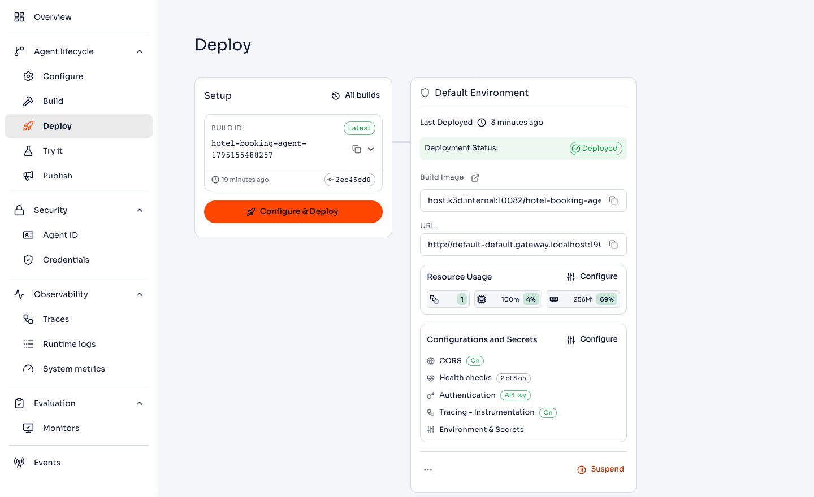

# Deploy an Agent

You deploy an agent's successful build to an environment. Open the agent, and in the left navigation, under **Agent lifecycle**, click **Deploy**.

If the agent has no successful build yet, the page shows **Build your agent first**. Click **Go to Build** and [build the agent](../develop/build-an-agent.mdx) first.

## Deploy a build

Agents created with **Create and deploy** deploy their first build automatically. To deploy again, follow these steps:

1. Click **Configure & Deploy**. The deployment uses the latest build. To use another build, click it under **BUILD ID**.
2. Review the environment variables. Add the values your agent needs, such as an LLM API key, and select **Mark as Secret** to hide a value.
3. Click **Apply & Deploy**.

The environment card shows **Deploying** and then **Deployed**. If the agent doesn't reach **Deployed**, check [Runtime Logs](../observability/runtime-logs.mdx). A missing environment variable is the most common cause.

## Manage a deployment

From the environment card you can:

- **Change resources.** Click **Configure** next to **Resource Usage** to set replicas, CPU, memory, and autoscaling.
- **Change settings.** Click **Configure** next to **Configurations and Secrets** to set CORS, health checks, authentication, and tracing.
- **Promote.** If the project has a later environment, click **Promote** to deploy the build there.
- **Suspend.** Click **Suspend** to remove the deployment without deleting the agent. Click **Re-deploy** to bring it back.

## Environments

An agent is deployed to the environments of its project. A project's environments come from its deployment pipeline, which you can see and change on the project's **Overview** page. The **Default Pipeline** is a standard deployment pipeline with development, staging, and production environments. See [Projects](../administer/projects.mdx).

The agent's **Overview** page shows its deployment in each environment, for example **Development**.

Once the agent is deployed, you can [try it](../test/try-your-agent.mdx) and [create API keys](../develop/security/api-keys.mdx) for it.
