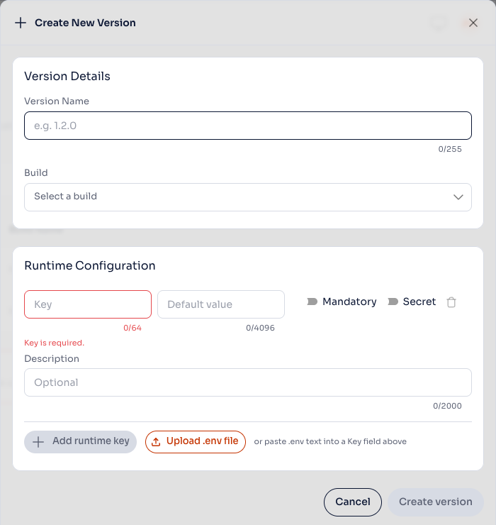

# Publish to the Agent Catalog

Publishing turns a built agent into an agent kind: a versioned template that appears in your organization's **Agent catalog**. Anyone in the organization can [create an agent from it](../create/create-from-the-agent-catalog.mdx).

Publishing is available for agents you build from source.

## Publish a version

1. Build the agent. See [Build an Agent](../develop/build-an-agent.mdx).
2. Under **Agent lifecycle**, click **Publish**, and then click **Create version**.
3. Enter a **Version Name**, such as `1.0.0`, and select the build. The first time, also review the kind's display name and description.
4. Under **Runtime Configuration**, add the environment variables that agents created from this version need. Mark a variable **Mandatory** to require a value, or **Secret** to hide it.
5. Click **Create version**.

A build can be published only once. To publish another version, run a new build and select it.

## Remove a kind

To remove a kind and all its versions from the catalog, click **Unpublish kind** at the bottom of the **Publish** page. This can't be undone.
