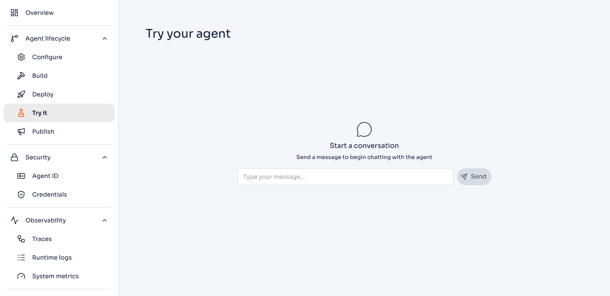

# Try Your Agent

Chat with a deployed agent or call its API from the Console, without writing a client. The agent must be [deployed](../deploy/deploy-an-agent.mdx) first.

To open it, click **Try it** under **Agent lifecycle**.

- **Chat agents:** type a message and click **Send**.
- **Other agents:** use the interactive API explorer, which is pre-authorized with a test API key.
- **A2A agents:** testing isn't available in the Console. Use an A2A-compatible client.

If a request fails, for example with a `500` error, a missing environment variable such as an LLM API key is a common cause. Check [Runtime Logs](../observability/runtime-logs.mdx) and [Traces](../observability/traces.mdx), fix the variable on the **Deploy** page, and try again.
