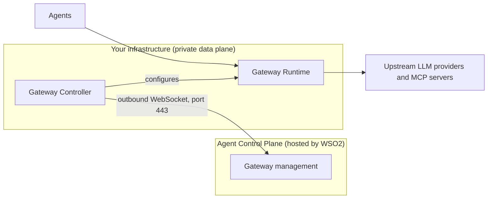

# Architecture

A self-hosted AI Gateway runs in a private data plane that you manage and connects to Agent Control Plane in the cloud. You manage LLM service providers, MCP servers, and policies centrally, while LLM and MCP traffic, runtime execution, and upstream connectivity stay within your own environment.

## Agent Control Plane

Agent Control Plane is hosted by WSO2. You use it to register gateways, deploy LLM service providers and MCP servers, and manage policies.

The gateway opens an outbound WebSocket connection to Agent Control Plane over **port 443**, using the registration token you configured. The gateway receives deployment and policy updates over this connection. Because the connection starts in your network, you do not need to expose the gateway's management services to the public internet.

## Private Data Plane

The private data plane runs in your infrastructure. It handles agent traffic, applies runtime policies, and communicates with upstream LLM providers and MCP servers. Requests from agents are processed entirely within this environment.

The gateway has two components.

### Gateway Controller

The Gateway Controller receives deployments and policy configuration from Agent Control Plane and configures the Gateway Runtime accordingly. It contains the following services.

| Service | Description |
|---|---|
| Controller REST API | Exposes the management API used by the control plane and internal gateway components. |
| Controller xDS | Provides runtime configuration to the router and policy distribution to the policy engine. |
| Database | Stores gateway configuration and runtime metadata. |

### Gateway Runtime

The Gateway Runtime handles traffic. It includes the router and the policy engine.

The router receives HTTP and HTTPS requests and routes them to the relevant LLM provider or MCP server. During request and response processing, the router calls the policy engine to run the configured policies, such as authentication, rate limiting, and guardrails.

## Default Ports

| Port | Component | Type | Description |
|---|---|---|---|
| `8080` | Gateway Runtime (router) | External | HTTP ingress for agent traffic. |
| `8443` | Gateway Runtime (router) | External | HTTPS ingress for agent traffic. |
| `9901` | Gateway Runtime (router) | Internal | Envoy admin console. |
| `9002` | Gateway Runtime (policy engine) | Internal | Policy engine admin API. |
| `9003` | Gateway Runtime (policy engine) | Internal | Policy engine metrics. Listens after you enable metrics. See [Monitor Gateway Metrics](./observability/monitor-gateway-metrics.mdx). |
| `9090` | Gateway Controller | Internal | Controller REST API. |
| `9094` | Gateway Controller | Internal | Controller admin and debug API. |
| `9011` | Gateway Controller | Internal | Controller metrics, the host port for container port `9091`. Listens after you enable metrics. |
| `18000` | Gateway Controller | Internal | Controller xDS, which configures the router. Not published to the host. |
| `18001` | Gateway Controller | Internal | Policy xDS, which configures the policy engine. Not published to the host. |

Only the ingress ports need to be reachable by agents. Keep the internal ports private. The Docker Compose file publishes the controller, admin, metrics, and Envoy ports on all host interfaces by default, so restrict them as described in [Production Hardening](./setting-up.mdx#production-hardening).

## Configuration Flow

When you deploy or change an LLM service provider, an MCP server, or a policy in Agent Control Plane, the configuration reaches the Gateway Controller over the outbound WebSocket connection.

The Gateway Controller stores the configuration and converts it into runtime configuration. Controller xDS then configures the router and the policy engine. Once configured, the Gateway Runtime serves traffic according to the routes and policies you defined.

## Runtime Traffic Flow

Agents send requests to the Gateway Runtime through the HTTP or HTTPS ingress ports.

The router identifies the matching route and applies the configured policy chain through the policy engine. After the policies succeed, the router forwards the request to the LLM provider or MCP server. The response follows the same path back, so response policies apply before the response reaches the agent.

## Key Benefits

This architecture keeps runtime execution close to your upstream services and limits the exposure of internal systems. You apply consistent policies across all LLM service providers and MCP servers from one place.

To keep serving traffic when a controller or runtime replica is unavailable, run more than one of each. See [High Availability](./high-availability.mdx).

## Related Concepts

- [Gateway](../../concepts/gateway.mdx): how gateways route traffic per environment.
- [Setting Up a Self-Hosted Gateway](./setting-up.mdx): install the gateway with Docker or Helm.
