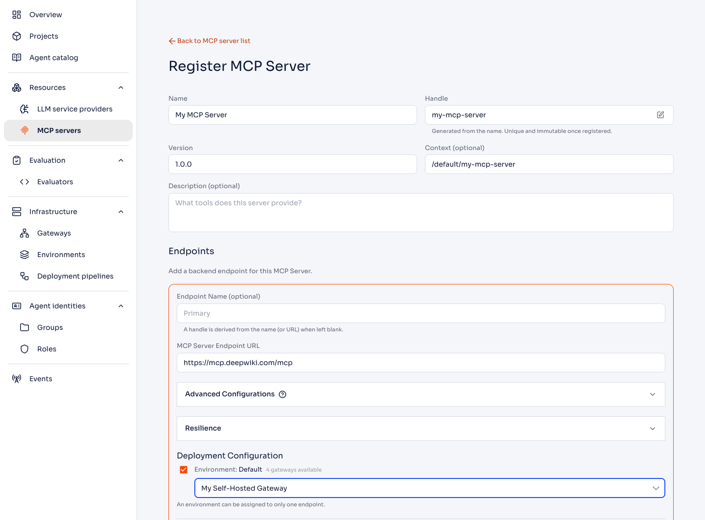
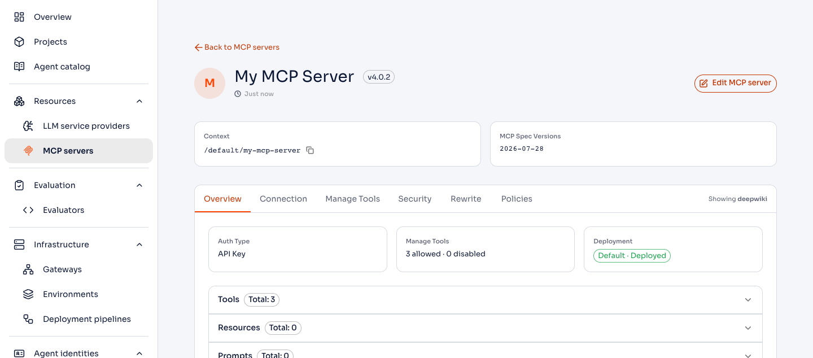

# Deploy an MCP Server

This guide deploys an MCP server to your self-hosted gateway and sends a request through it.

## Prerequisites

- A self-hosted gateway that shows **Active** in Agent Control Plane. If you do not have one, follow the [Quick Start Guide](./quickstart-guide.mdx).
- A machine that can reach the gateway **Public URL**.
- The public URL of an MCP server. Private and localhost addresses are rejected.

The gateway calls the MCP server, not Agent Control Plane, so the gateway host needs outbound access to it.

:::note
A self-hosted gateway is never selected for you. Select it explicitly when you deploy.
:::

## Step 1: Register and Deploy the MCP Server

1. Go to **Resources** → **MCP servers** and click **Register MCP server**.
2. Enter a **Name**. The **Handle** is generated from it and cannot be changed later. Keep the default **Version**, or enter your own. Optionally, set the **Context**.
3. Under **Endpoints**, click **Add endpoint** and enter the **MCP Server Endpoint URL**. Agent Control Plane reads the server and shows how many tools, resources, and prompts it exposes.
4. Under **Deployment Configuration**, select the environment, then select your self-hosted gateway.
5. Click **Add endpoint**, then click **Create**.



The server page shows **Deployed** next to the deployment. The controller logs show `Runtime deploy config added` with `kind=Mcp`.



:::note
Self-hosted gateways support API key security for MCP servers only. On the **Security** tab, the method is **API Key**, and the key is sent in the `X-API-Key` header by default.
:::

## Step 2: Test the MCP Server

The MCP endpoint on the gateway is the gateway **Public URL**, the server context, and `/mcp`, for example `https://localhost:8443/default/my-mcp-server/mcp`.

1. Send an MCP `initialize` request without a key to confirm that the gateway serves the endpoint:

   ```bash
   curl -k -X POST "https://localhost:8443/default/my-mcp-server/mcp" \
     -H "Content-Type: application/json" \
     -H "Accept: application/json, text/event-stream" \
     -d '{"jsonrpc":"2.0","id":1,"method":"initialize","params":{"protocolVersion":"2025-03-26","capabilities":{},"clientInfo":{"name":"test","version":"1.0"}}}'
   ```

   The gateway answers `401` with `Valid API key required`. The route exists and the gateway enforces authentication.

2. Get a key. Agents receive their own keys when you attach the MCP server to an agent as a tool configuration. Generate the key there, then send it in the `X-API-Key` header with the same request. The server answers with its capabilities.

## Troubleshooting

| Symptom | Cause and fix |
|---|---|
| The self-hosted gateway is not in the gateway list | It belongs to a different environment, or it has not connected. Check its environment and status under **Infrastructure** → **Gateways**. |
| The status stays **Deploying** | The gateway did not acknowledge the deployment. Check that it is **Active**, then read `docker compose logs gateway-controller`. |
| `curl: (60) SSL certificate problem` | The listener certificate is self-signed. Use `-k`, pass `--cacert`, or install a certificate for your gateway hostname. |
| `404` from the gateway | The path does not match a deployed route. Check the context and the path, and confirm that the deployment shows **Deployed**. |
| `502` or `503` from the gateway | The gateway cannot reach the upstream. Check DNS and network routing from the gateway host or pod to the MCP server. |
| The MCP endpoint has the wrong host or port | The endpoint uses the gateway **Public URL**. Update it with **Edit gateway** under **Infrastructure** → **Gateways**. |

## Next Steps

- [Deploy an LLM Service Provider](./deploy-an-llm-service-provider.mdx)
- [MCP Servers](../../agent-control-plane/create/mcp-servers.mdx)
- [Register an MCP Proxy](../../guides/register-mcp-proxy.mdx)
- [Configure MCP Proxies for an Agent](../../guides/configure-agent-mcp-proxies.mdx)
