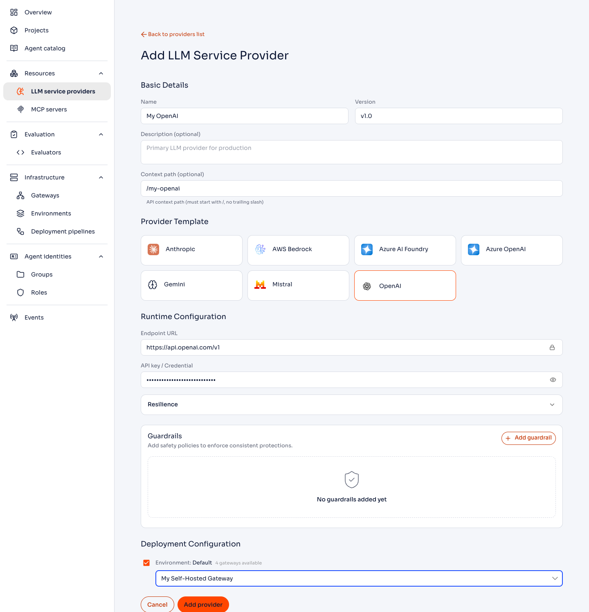
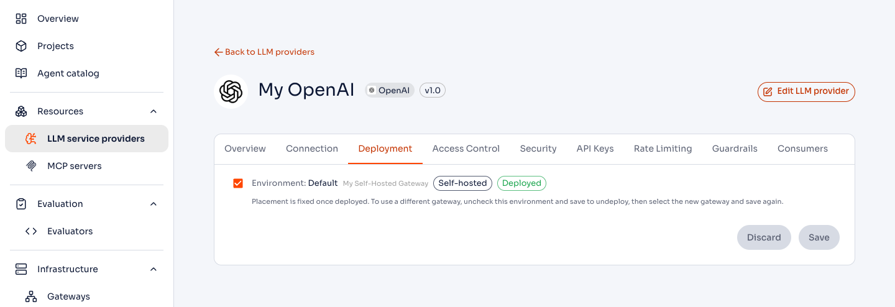
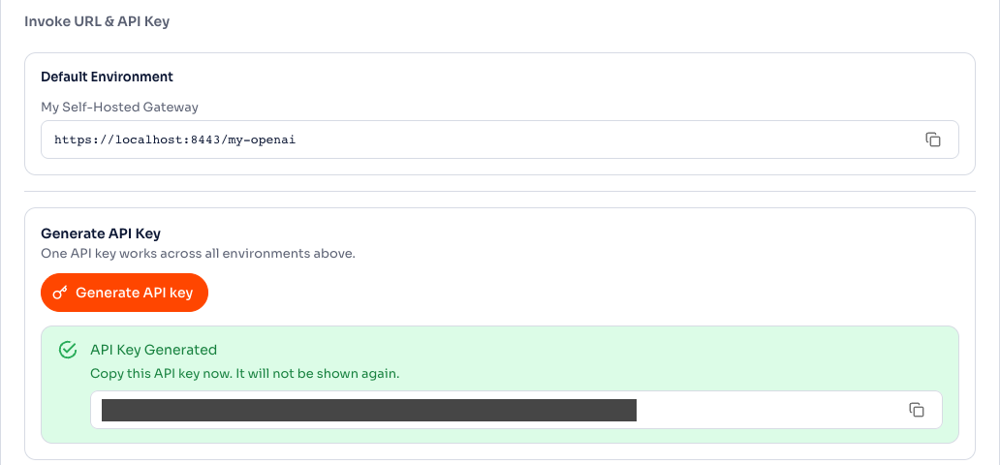
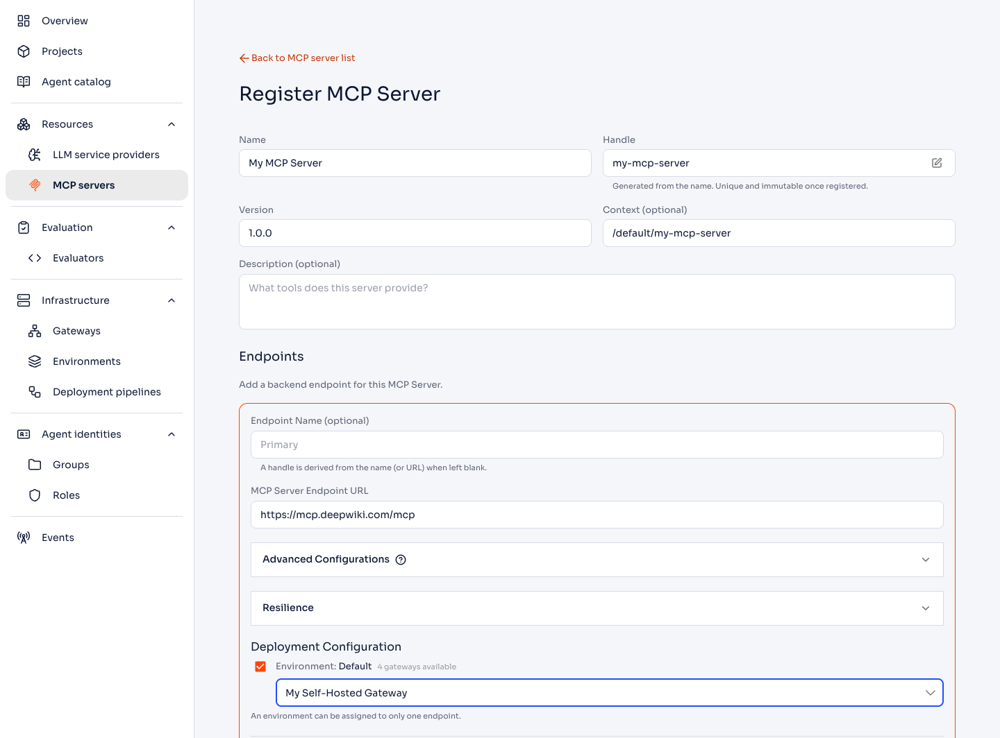
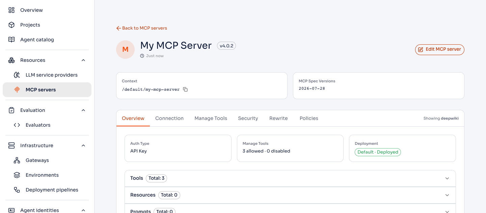

# Deploy and Test on a Self-Hosted Gateway

This guide deploys an LLM service provider and an MCP server to your self-hosted gateway and sends a request through each one.

## Prerequisites

- A self-hosted gateway that shows **Active** in Agent Control Plane. If you do not have one, follow the [Quick Start Guide](./quickstart-guide.mdx).
- A machine that can reach the gateway **Public URL**.
- A credential for the LLM provider you want to use.
- The public URL of an MCP server. Private and localhost addresses are rejected.

The gateway calls the LLM provider and the MCP server, not Agent Control Plane, so the gateway host needs outbound access to them.

:::note
A self-hosted gateway is never selected for you. Select it explicitly when you deploy.
:::

## Deploy an LLM Service Provider

### Step 1: Register and Deploy the Provider

1. In [Agent Control Plane](https://console.agent-manager.cloud.wso2.com/), go to **Resources** → **LLM service providers** and click **Add service provider**.
2. Enter a **Name** and a **Version** in the form `v1.0`. Optionally, enter a **Context path** such as `/my-openai`. It becomes part of the invoke URL.
3. Select a **Provider Template**, for example **OpenAI**. The template fills in the **Endpoint URL**.
4. Enter your credential in **API key / Credential**. The gateway sends it upstream, so agents never handle it.
5. Under **Deployment Configuration**, select the environment, then select your self-hosted gateway from the gateway list. The list shows **Self-hosted** next to it.
6. Click **Add provider**.



The provider page opens. Under **Deployment**, the environment shows the gateway as **Deploying**, then **Deployed**. Reload the page if the status does not change.



On the gateway host, the controller logs show the deployment arriving and being applied:

```bash
docker compose logs gateway-controller | grep -i "llm provider"
```

```text
msg="Successfully processed LLM provider deployment event" provider_id=...
msg="Runtime deploy config added" key=LlmProvider:my-openai kind=LlmProvider ...
```

### Step 2: Test the Provider

1. On the provider's **Overview** tab, find **Invoke URL & API Key**. The invoke URL combines the gateway **Public URL** with the provider context, for example `https://localhost:8443/my-openai`.
2. Click **Generate API key** and copy the key. The key is shown once and works in all environments.

   

3. Send a request with the key in the `API-Key` header. The default listener certificate is self-signed, so add `-k` until you install a trusted certificate.

   ```bash
   curl -k -X POST "https://localhost:8443/my-openai/chat/completions" \
     -H "API-Key: <API_KEY>" \
     -H "Content-Type: application/json" \
     -d '{"model": "gpt-4o-mini", "messages": [{"role": "user", "content": "Hello"}]}'
   ```

The gateway checks the key, adds the provider credential, and forwards the request. A valid credential returns a chat completion.

| Response | Meaning |
|---|---|
| `401` with `Valid API key required` | The request reached the gateway, but the `API-Key` header is missing or invalid. |
| `401` with an error from the LLM provider, such as `Incorrect API key provided` | The request reached the provider. Correct the credential on the provider's **Connection** tab. |

## Deploy an MCP Server

### Step 1: Register and Deploy the Server

1. Go to **Resources** → **MCP servers** and click **Register MCP server**.
2. Enter a **Name**. The **Handle** is generated from it and cannot be changed later. Keep the default **Version**, or enter your own. Optionally, set the **Context**.
3. Under **Endpoints**, click **Add endpoint** and enter the **MCP Server Endpoint URL**. Agent Control Plane reads the server and shows how many tools, resources, and prompts it exposes.
4. Under **Deployment Configuration**, select the environment, then select your self-hosted gateway.
5. Click **Add endpoint**, then click **Create**.



The server page shows **Deployed** next to the deployment. The controller logs show `Runtime deploy config added` with `kind=Mcp`.



:::note
Self-hosted gateways support API key security for MCP servers only. On the **Security** tab, the method is **API Key**, and the key is sent in the `X-API-Key` header by default.
:::

### Step 2: Test the Server

The MCP endpoint on the gateway is the gateway **Public URL**, the server context, and `/mcp`, for example `https://localhost:8443/default/my-mcp-server/mcp`.

1. Send an MCP `initialize` request without a key to confirm that the gateway serves the endpoint:

   ```bash
   curl -k -X POST "https://localhost:8443/default/my-mcp-server/mcp" \
     -H "Content-Type: application/json" \
     -H "Accept: application/json, text/event-stream" \
     -d '{"jsonrpc":"2.0","id":1,"method":"initialize","params":{"protocolVersion":"2025-03-26","capabilities":{},"clientInfo":{"name":"test","version":"1.0"}}}'
   ```

   The gateway answers `401` with `Valid API key required`. The route exists and the gateway enforces authentication.

2. Get a key. Agents receive their own keys when you attach the MCP server to an agent as a tool configuration. Generate the key there, then send it in the `X-API-Key` header with the same request. The server answers with its capabilities.

## Update or Remove a Deployment

- **Move to another gateway.** A provider keeps its gateway. On the provider's **Deployment** tab, clear the environment and click **Save** to undeploy. Then select the new gateway and save again.
- **Undeploy.** Clear the environment on the **Deployment** tab and click **Save**. The gateway removes the routes, and the invoke URLs stop working.
- **Gateway offline during a change.** The gateway synchronizes its deployments again when it reconnects.

## Troubleshooting

| Symptom | Cause and fix |
|---|---|
| The self-hosted gateway is not in the gateway list | It belongs to a different environment, or it has not connected. Check its environment and status under **Infrastructure** → **Gateways**. |
| The status stays **Deploying** | The gateway did not acknowledge the deployment. Check that it is **Active**, then read `docker compose logs gateway-controller`. |
| `curl: (60) SSL certificate problem` | The listener certificate is self-signed. Use `-k`, pass `--cacert`, or install a certificate for your gateway hostname. |
| `404` from the gateway | The path does not match a deployed route. Check the context and the path, and confirm that the deployment shows **Deployed**. |
| `502` or `503` from the gateway | The gateway cannot reach the upstream. Check DNS and network routing from the gateway host or pod to the LLM provider or MCP server. |
| The invoke URL has the wrong host or port | The URL uses the gateway **Public URL**. Update it with **Edit gateway** under **Infrastructure** → **Gateways**. |

## Next Steps

- [LLM Service Providers](../../agent-control-plane/administer/llm-service-providers.mdx)
- [Register an LLM Service Provider](../../guides/register-llm-service-provider.mdx)
- [MCP Servers](../../agent-control-plane/create/mcp-servers.mdx)
- [Register an MCP Proxy](../../guides/register-mcp-proxy.mdx)
- [Configure MCP Proxies for an Agent](../../guides/configure-agent-mcp-proxies.mdx)
