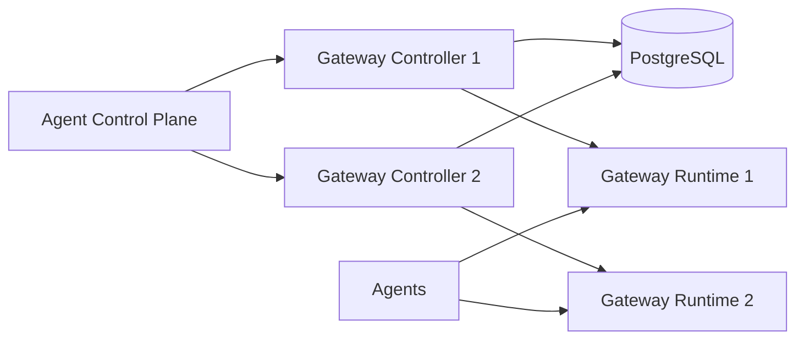

# High Availability

A self-hosted AI Gateway can run with more than one Gateway Controller replica and more than one Gateway Runtime replica, including replicas in different network zones or environments. For the components of a single gateway, see [Architecture](./architecture.mdx).

Agent Control Plane sends a deployment to one of the Gateway Controller replicas. That controller stores the deployment in the shared PostgreSQL database. The other Gateway Controller replicas read the updated deployment state from the database and synchronize the configuration with the Gateway Runtime instances connected to them.

Every Gateway Controller replica then works from the same deployment state, and each runtime environment receives the latest configuration.

## Architecture

| Component | Description |
|---|---|
| Gateway Controller | Receives deployment requests, stores deployment state in the database, and synchronizes runtime configuration with the Gateway Runtime instances connected to it. |
| PostgreSQL database | Shared source of truth for deployment state and gateway configuration. |
| Gateway Runtime | Receives configuration from its connected Gateway Controller and enforces policies on traffic. |



Each Gateway Controller replica can manage one or more Gateway Runtime replicas.

## Deployment Synchronization

One of the available Gateway Controller replicas handles a deployment request.

That controller validates the deployment and stores the deployment state in the shared PostgreSQL database. The other Gateway Controller replicas read the latest deployment state from the database. When a controller detects a new or updated deployment, it generates the runtime configuration and synchronizes it with the Gateway Runtime instances connected to that controller.

Each Gateway Runtime applies the configuration it receives and starts serving the deployed LLM service providers and MCP proxies.

## High Availability

High availability removes the dependency on a single controller instance.

If Gateway Controller replica 1 receives a deployment request, it stores the deployment state in PostgreSQL. Gateway Controller replica 2 reads the same state from the database and synchronizes it with the Gateway Runtime replicas connected to it.

If one Gateway Controller replica becomes unavailable, another replica can continue to process deployment requests and synchronize runtime configuration from the state stored in the database.

You can also run more than one Gateway Runtime replica in each environment, so traffic continues when one runtime replica is unavailable.

## Configuration Synchronization

The PostgreSQL database is the synchronization point between Gateway Controller replicas. It keeps the latest deployment state so every controller replica stays consistent. Controllers poll the database every 3 seconds by default.

Gateway Runtime replicas do not read the database. They receive runtime configuration from the Gateway Controller they are connected to.

## Configure Replicas on Kubernetes

1. Store the database password in a Kubernetes secret:

   ```bash
   kubectl create secret generic gateway-db-password --from-literal=password=<DB_PASSWORD>
   ```

2. Add these values to the `helm install` command, or to a values file:

   ```bash
   --set gateway.config.controller.storage.type=postgres \
   --set gateway.config.controller.storage.postgres.host=<DB_HOST> \
   --set gateway.config.controller.storage.postgres.database=<DB_NAME> \
   --set gateway.config.controller.storage.postgres.user=<DB_USER> \
   --set gateway.controller.postgres.passwordSecretRef.name=gateway-db-password \
   --set gateway.controller.deployment.replicaCount=2 \
   --set gateway.gatewayRuntime.deployment.replicaCount=2
   ```

   Replace the placeholders with your database details. The `sslmode` value defaults to `require`.

The chart also supports a PodDisruptionBudget (`gateway.controller.podDisruptionBudget.enabled`) and autoscaling (`gateway.controller.hpa.enabled` and `gateway.gatewayRuntime.hpa.enabled`). Autoscaling the controller requires a PostgreSQL or SQL Server database.
