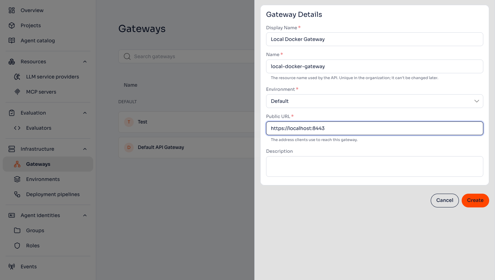
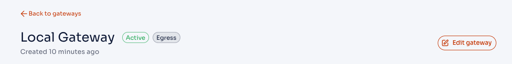

# Quick Start Guide

This guide runs a self-hosted AI Gateway in Docker and connects it to your Agent Control Plane organization. For Kubernetes or production installs, see [Setting Up a Self-Hosted Gateway](./setting-up.mdx).

## Prerequisites

- Docker with Docker Compose v2, `curl`, and `unzip`.
- Outbound network access to Agent Control Plane.
- Free ports `8080`, `8081`, `8443`, `9002`, `9003`, `9011`, `9090`, `9094`, and `9901`. If one is in use, see [Port Already in Use](./setting-up.mdx#port-already-in-use) before you add the gateway.

## Add the Gateway

1. In [Agent Control Plane](#), go to **Infrastructure** → **Gateways** and click **Add gateway**.
2. Enter a **Display Name**, select the **Environment**, and enter the **Public URL**, the address clients use to reach the gateway. For a local run, use `https://localhost:8443`. The **Public URL** cannot be changed later. If you remap the HTTPS port, enter the port that you will use.
3. Click **Create**.



The **Name** is filled in from the display name. It is unique in the organization and cannot be changed later.

## Run the Gateway

Agent Control Plane opens a setup panel with the commands for your gateway. Run them in order:

1. **Download the gateway.** Downloads and unpacks the AI Gateway distribution.
2. **Set up the gateway.** Runs `./scripts/setup.sh`, which creates the encryption key and `api-platform.env`, and keeps the listener certificate that ships in the distribution. It also prints admin credentials for the controller's management API once, so copy them if you need that API.
3. **Configure the gateway.** Appends the control plane host and your registration token to `api-platform.env`.
4. **Start the gateway.** Runs `docker compose up`, which keeps running in your terminal. Open a second terminal for the verification below, or run `docker compose up -d` instead.

:::warning
The registration token is shown only once. The **Copy** button on step 3 copies the command with your real token. The text on the screen shows a `<your-gateway-token>` placeholder, so do not copy it by selecting the text. If you lose it, see [Manage Registration Tokens](./setting-up.mdx#manage-registration-tokens).
:::

## Verify the Gateway

Open the gateway under **Infrastructure** → **Gateways**. A few seconds after the containers start, the status changes from **Inactive** to **Active**.



To check from the gateway host, run these commands in the gateway folder:

```bash
curl -s http://localhost:8080/_gateway-health/healthy
docker compose logs gateway-controller | grep "Connection state changed"
```

A healthy response and a `to=connected` log line mean that the gateway is connected. If you remapped the HTTP port, use that port in the first command. If it stays **Inactive**, see [Troubleshooting](./setting-up.mdx#troubleshooting).

## Next Steps

- [Route LLM Traffic Through a Self-Hosted Gateway](./route-llm-traffic.mdx)
- [Route MCP Traffic Through a Self-Hosted Gateway](./route-mcp-traffic.mdx)
- [Install a Self-Hosted Gateway for Production](./setting-up.mdx)
