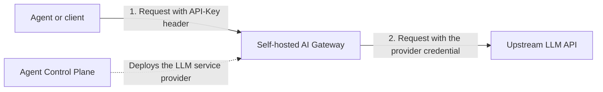
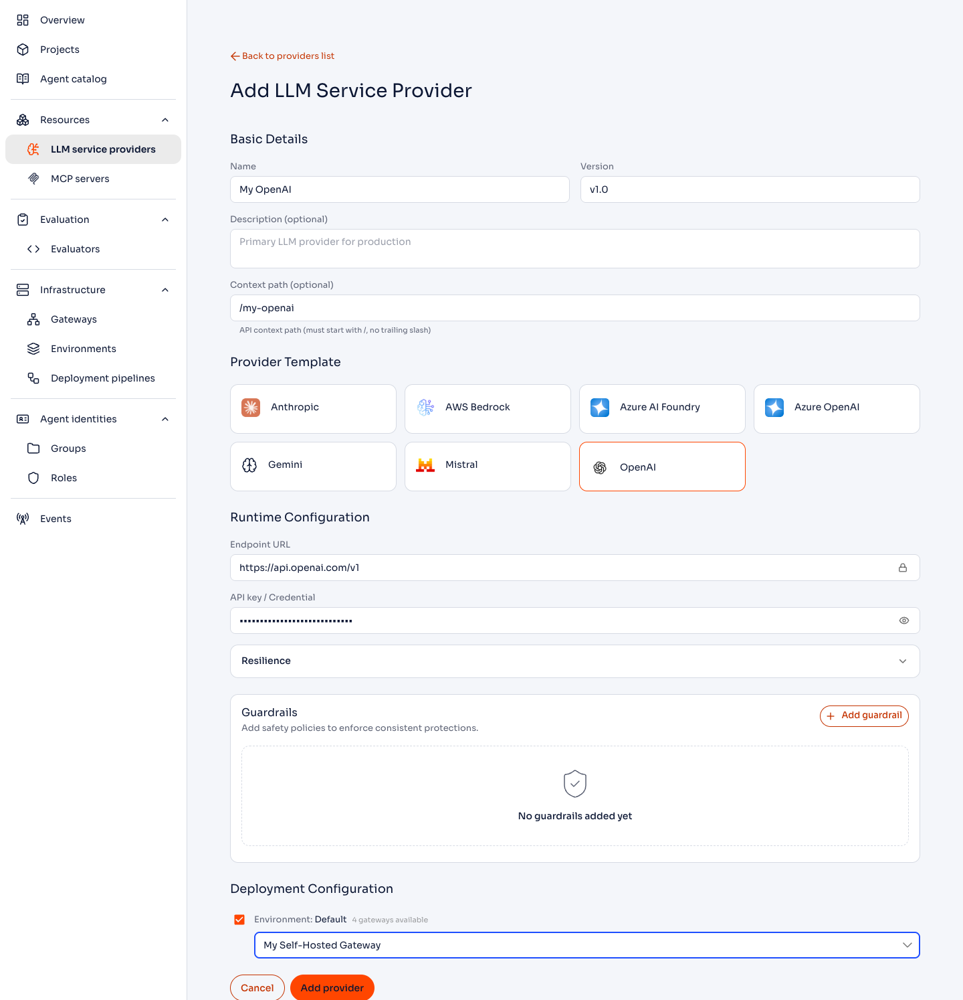
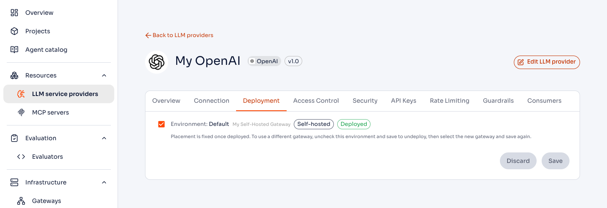
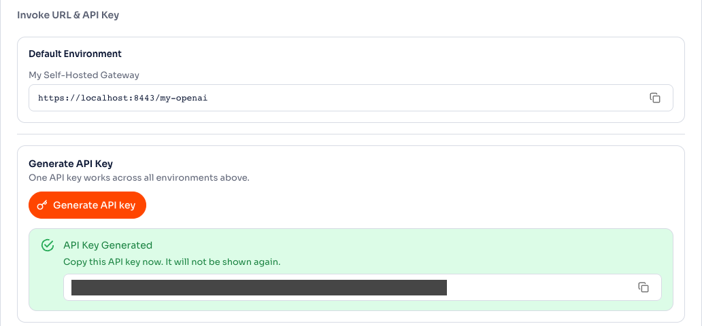

# Route LLM Traffic Through a Self-Hosted Gateway

An LLM service provider connects Agent Control Plane to an upstream LLM API, such as OpenAI. When you deploy it to your self-hosted gateway, the gateway becomes the single entry point for that LLM API. Agents call the gateway, and the gateway calls the LLM API.

## How It Works



- **You configure it once, in Agent Control Plane.** The LLM service provider holds the upstream URL and your credential for the LLM API. Deploying it sends that configuration to your gateway.
- **Agents hold a gateway API key, not your credential.** The key identifies the caller to the gateway, so the upstream credential stays out of agent code.
- **The gateway forwards the request.** It checks the key, adds the upstream credential, and sends the request to the LLM API. The access control, rate limiting, and guardrails that you set on the LLM service provider apply here.
- **Traffic stays on your side.** Requests flow from the agent to your gateway and from your gateway to the LLM API. They do not pass through Agent Control Plane.

This guide registers an LLM service provider, deploys it to your gateway, and sends a request that follows this path.

## Prerequisites

- A self-hosted gateway that shows **Active** in Agent Control Plane. If you do not have one, follow the [Quick Start Guide](./quickstart-guide.mdx).
- A machine that can reach the gateway **Public URL**.
- A credential for the upstream LLM API you want to use, such as an OpenAI API key.

The gateway host needs outbound access to the LLM API.

## Step 1: Register the LLM Service Provider and Deploy It to the Gateway

:::note
A self-hosted gateway is never selected for you. Select it explicitly when you deploy.
:::

1. In [Agent Control Plane](#), go to **Resources** → **LLM service providers** and click **Add service provider**.
2. Enter a **Name** and a **Version** in the form `v1.0`. Optionally, enter a **Context path** such as `/my-openai`. The context path becomes part of the URL that agents call.
3. Select a **Provider Template**, for example **OpenAI**. The template fills in the **Endpoint URL** of the LLM API.
4. Enter your credential in **API key / Credential**. The gateway sends it to the LLM API, so agents never handle it.
5. Under **Deployment Configuration**, select the **Environment** check box, which is cleared by default. A gateway list appears and shows the managed **Default API Gateway**. Select your self-hosted gateway, which shows **Self-hosted** next to it.
6. Click **Add provider**.



The LLM service provider page opens. Under **Deployment**, the environment shows the gateway as **Deploying**, then **Deployed**. Reload the page if the status does not change.



On the gateway host, the controller logs show the configuration arriving:

```bash
docker compose logs gateway-controller | grep "Runtime deploy config added"
```

```text
msg="Runtime deploy config added" key=LlmProvider:my-openai kind=LlmProvider ...
```

## Step 2: Get the Invoke URL and an API Key

1. On the LLM service provider's **Overview** tab, find **Invoke URL & API Key**. The invoke URL is the gateway **Public URL** plus the context path, for example `https://localhost:8443/my-openai`. Agents call this URL instead of the LLM API.
2. Click **Generate API key** and copy the key. The key is shown once and works in all environments.



## Step 3: Send a Request Through the Gateway

Send a request to the invoke URL, followed by the API path of the LLM API. Put the key in the `API-Key` header. The default listener certificate is self-signed, so add `-k` until you install a trusted certificate.

```bash
curl -k -X POST "https://localhost:8443/my-openai/chat/completions" \
  -H "API-Key: <API_KEY>" \
  -H "Content-Type: application/json" \
  -d '{"model": "gpt-4o-mini", "messages": [{"role": "user", "content": "Hello"}]}'
```

The gateway checks the key, adds the credential that you entered for the LLM service provider, and forwards the request. A valid credential returns a chat completion. The response tells you how far the request got:

| Response | Meaning |
|---|---|
| A chat completion | The whole path works, from the client through the gateway to the LLM API. |
| `401` with `Valid API key required` | The request reached the gateway, but the `API-Key` header is missing or invalid. |
| `401` with an error from the upstream LLM API, such as `Incorrect API key provided` | The request passed the gateway and reached the LLM API. Correct the credential on the LLM service provider's **Connection** tab. |

## Update or Remove a Deployment

- **Move to another gateway.** An LLM service provider keeps its gateway. On its **Deployment** tab, clear (uncheck) the **Environment** box and click **Save** to undeploy. Then select the new gateway and save again.
- **Undeploy.** Clear (uncheck) the **Environment** box on the **Deployment** tab and click **Save**. The gateway removes the routes, and the invoke URLs stop working.
- **Gateway offline during a change.** The gateway synchronizes its deployments again when it reconnects.

## Troubleshooting

| Symptom | Cause and fix |
|---|---|
| The self-hosted gateway is not in the gateway list | It belongs to a different environment, or it has not connected. Check its environment and status under **Infrastructure** → **Gateways**. |
| The status stays **Deploying** | The gateway did not acknowledge the deployment. Check that it is **Active**, then read `docker compose logs gateway-controller`. |
| `curl: (60) SSL certificate problem` | The listener certificate is self-signed. Use `-k`, pass `--cacert`, or install a certificate for your gateway hostname. |
| `404` from the gateway | The path does not match a deployed route, or another service owns the port that you called. Check the context and the path, confirm that the deployment shows **Deployed**, and check which service listens on that port. |
| `502` or `503` from the gateway | The gateway cannot reach the upstream. Check DNS and network routing from the gateway host or pod to the upstream LLM provider. |
| The invoke URL has the wrong host or port | The URL uses the gateway **Public URL**, which cannot be changed after you create the gateway. Create a new gateway with the correct URL and deploy to it. |

## Next Steps

- [Route MCP Traffic Through a Self-Hosted Gateway](./route-mcp-traffic.mdx)
- [LLM Service Providers](../../agent-control-plane/administer/llm-service-providers.mdx)
- [Register an LLM Service Provider](../../guides/register-llm-service-provider.mdx)
