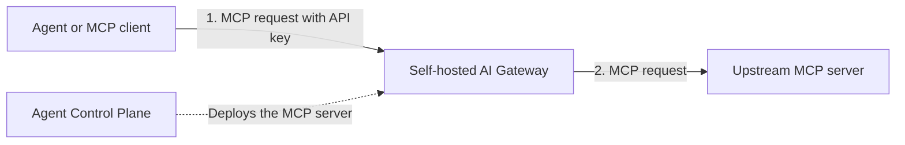
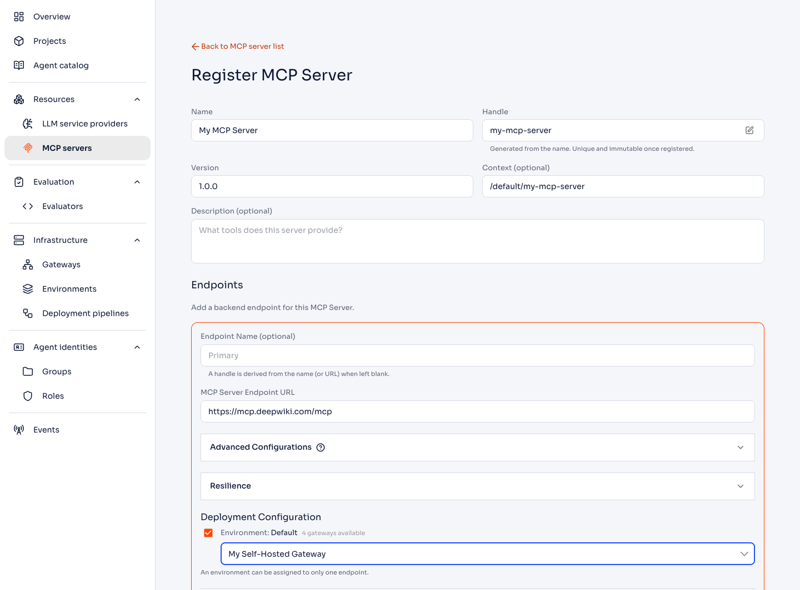
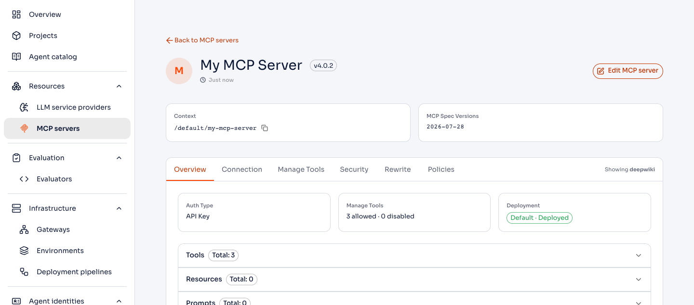

# Route MCP Traffic Through a Self-Hosted Gateway

An MCP server provides tools, resources, and prompts to agents over the Model Context Protocol. When you deploy it to your self-hosted gateway, agents connect to the gateway instead of the MCP server. The gateway authenticates them and forwards their requests.

## How It Works



- **You register the MCP server once, in Agent Control Plane.** The registration holds the MCP server URL and the environments it serves. Deploying it sends that configuration to your gateway.
- **Agents connect to the gateway endpoint.** They authenticate with an API key that the gateway checks on every request.
- **The gateway forwards the request.** It applies the tool access that you set under **Manage Tools** and sends the request to the MCP server.
- **Traffic stays on your side.** Requests flow from the agent to your gateway and from your gateway to the MCP server. They do not pass through Agent Control Plane.

This guide registers an MCP server, deploys it to your gateway, and checks the endpoint on the gateway.

## Prerequisites

- A self-hosted gateway that shows **Active** in Agent Control Plane. If you do not have one, follow the [Quick Start Guide](./quickstart-guide.mdx).
- A machine that can reach the gateway **Public URL**.
- The public URL of an MCP server. Private and localhost addresses are rejected.

The gateway host needs outbound access to the MCP server.

## Step 1: Register the MCP Server and Deploy It to the Gateway

:::note
A self-hosted gateway is never selected for you. Select it explicitly when you deploy.
:::

1. In [Agent Control Plane](#), go to **Resources** → **MCP servers** and click **Register MCP server**.
2. Enter a **Name**. The **Handle** is generated from it and cannot be changed later. Keep the default **Version**. Agent Control Plane replaces it with the version that the MCP server reports. Optionally, set the **Context**.
3. Under **Endpoints**, click **Add endpoint** and enter the **MCP Server Endpoint URL**. Agent Control Plane reads the server and shows how many tools, resources, and prompts it exposes.
4. Under **Deployment Configuration**, select the **Environment** check box, which is cleared by default. A gateway list appears and shows the managed **Default API Gateway**. Select your self-hosted gateway.
5. Click **Add endpoint**, then click **Create**.



After you click **Create**, the MCP servers list opens. Open the server from the list. The **Overview** tab shows **Deployed** next to the deployment. The controller logs show `Runtime deploy config added` with `kind=Mcp`.



:::note
Self-hosted gateways support API key security for MCP servers only. On the **Security** tab, the method is **API Key**, and the key is sent in the `X-API-Key` header by default.
:::

## Step 2: Find the Endpoint on the Gateway

The MCP endpoint on the gateway is the gateway **Public URL**, the server context, and `/mcp`, for example `https://localhost:8443/default/my-mcp-server/mcp`. Agents and MCP clients connect to this endpoint instead of the MCP server URL.

## Step 3: Check the Endpoint on the Gateway

Send an MCP `initialize` request without a key to confirm that the gateway serves the endpoint. The default listener certificate is self-signed, so add `-k` until you install a trusted certificate.

```bash
curl -k -X POST "https://localhost:8443/default/my-mcp-server/mcp" \
  -H "Content-Type: application/json" \
  -H "Accept: application/json, text/event-stream" \
  -d '{"jsonrpc":"2.0","id":1,"method":"initialize","params":{"protocolVersion":"2025-03-26","capabilities":{},"clientInfo":{"name":"test","version":"1.0"}}}'
```

The gateway answers `401` with `Valid API key required`. The endpoint exists, and the gateway enforces authentication on every request.

| Response | Meaning |
|---|---|
| `401` with `Valid API key required` | The gateway serves the endpoint and requires an API key. |
| `404` | The path does not match a deployed route. Check the context and confirm that the deployment shows **Deployed**. |

## Troubleshooting

| Symptom | Cause and fix |
|---|---|
| The self-hosted gateway is not in the gateway list | It belongs to a different environment, or it has not connected. Check its environment and status under **Infrastructure** → **Gateways**. |
| The status stays **Deploying** | The gateway did not acknowledge the deployment. Check that it is **Active**, then read `docker compose logs gateway-controller`. |
| `curl: (60) SSL certificate problem` | The listener certificate is self-signed. Use `-k`, pass `--cacert`, or install a certificate for your gateway hostname. |
| `404` from the gateway | The path does not match a deployed route, or another service owns the port that you called. Check the context and the path, confirm that the deployment shows **Deployed**, and check which service listens on that port. |
| `502` or `503` from the gateway | The gateway cannot reach the upstream. Check DNS and network routing from the gateway host or pod to the MCP server. |
| The MCP endpoint has the wrong host or port | The endpoint uses the gateway **Public URL**, which cannot be changed after you create the gateway. Create a new gateway with the correct URL and deploy to it. |

## Next Steps

- [Route LLM Traffic Through a Self-Hosted Gateway](./route-llm-traffic.mdx)
- [MCP Servers](../../agent-control-plane/create/mcp-servers.mdx)
- [Register an MCP Server](../../guides/register-mcp-proxy.mdx)
- [Configure MCP Servers for an Agent](../../guides/configure-agent-mcp-proxies.mdx)
