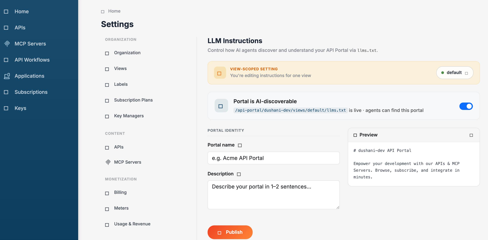

**LLM Instructions** controls how AI agents see this view. It sets the name and description at the top of `llms.txt` - the first thing an agent reads - and carries the switch that turns AI discoverability on or off. The setting applies to one [view](https://choreolabs.com/documentation/api-management/cloud/api-portal/administer/organization/manage-views/). Use the view selector to switch views.

1. Sign in to the API Portal & AI Hub as an administrator.
2. Open **Settings**.
3. Under **AI & DISCOVERY**, select **LLM Instructions**.

The page puts the fields beside a preview of the `llms.txt` they produce.



## Turn AI discoverability on or off

**Portal is AI-discoverable** shows the view's `llms.txt` path. While it is on, that file is live and agents can find this portal.

The path has this shape:

```text
/api-portal/{organization}/views/{view}/llms.txt
```

Switching it off makes every agent-facing endpoint for the view return `404`: `llms.txt` itself, the API and MCP catalogs, per-artifact Markdown, raw specifications, and every workflow endpoint. It overrides each artifact's own agent-visibility setting, so nothing reaches an agent while it is off.

**Publish** stays available when the switch is off, so you can save the change.

## Set the portal identity

Two fields make up the instructions, and both appear at the top of `llms.txt`.

| Field | Description |
|---|---|
| **Portal name** | The heading at the top of `llms.txt`. The placeholder is `e.g. Acme API Portal`. |
| **Description** | The paragraph under the heading. The placeholder asks you to describe the portal in one or two sentences. |

Use the description for context an agent cannot infer from individual API specifications:

- What the portal covers, and what kinds of APIs it exposes
- How the catalog is organized, by domain, team, or lifecycle stage
- Authentication conventions that apply across APIs
- Which workflows are the recommended starting points for common tasks
- Usage policies or limitations agents should respect

When the name and description are empty, the preview uses the heading `<organization-name> API Portal` and the description "Empower your development with our APIs & MCP Servers. Browse, subscribe, and integrate in minutes." Click **Publish** to save. The next request for `llms.txt` reflects the change.

## Preview the result

**Preview** shows the `llms.txt` those fields produce, and refreshes as you type, so you can see the header above the generated API and workflow index. The icon in its corner opens the live `llms.txt` in a new tab.

To fetch it yourself:

```text
GET /api-portal/{organization}/views/{view}/llms.txt
```

Only the name and description are editable. Everything below them - the **API Workflows**, **APIs**, **MCPs**, **GraphQL APIs**, **Async / WebSocket APIs**, and **WebSub APIs** sections - is generated from the catalog and reflects each artifact's own agent visibility. See [AI Agent Discovery](../discover/ai-agent-discovery.mdx).

## Related

- [API Workflows](https://choreolabs.com/documentation/api-management/cloud/api-portal/administer/ai-and-discovery/api-workflows/)
- [Make an API AI-Ready](https://choreolabs.com/documentation/api-management/cloud/api-control-plane/publish/make-an-api-ai-ready/)
- [Manage Views](https://choreolabs.com/documentation/api-management/cloud/api-portal/administer/organization/manage-views/)
