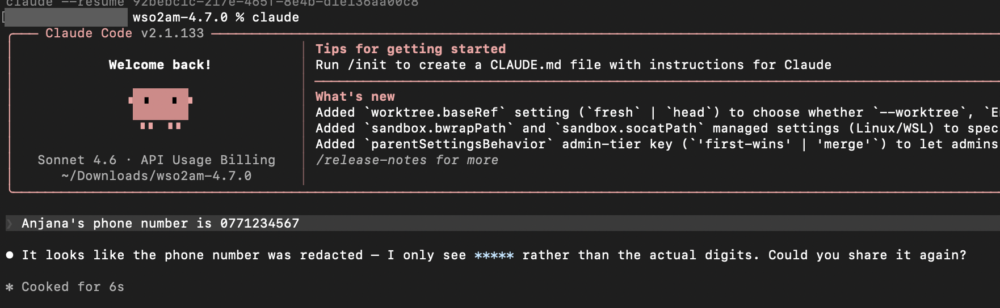
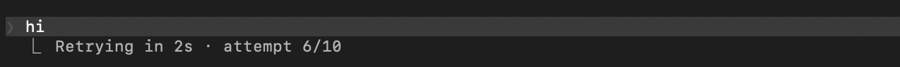
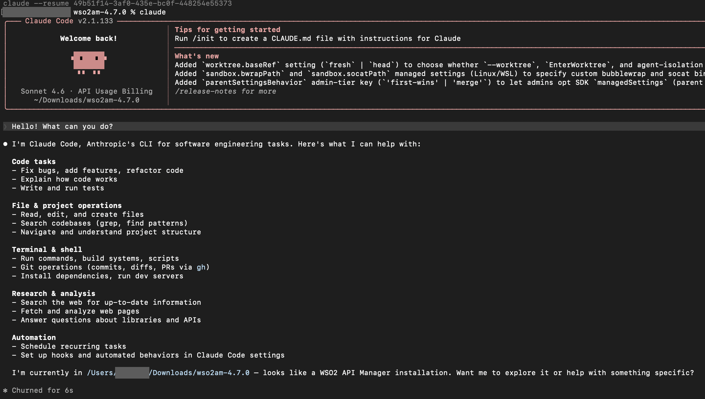
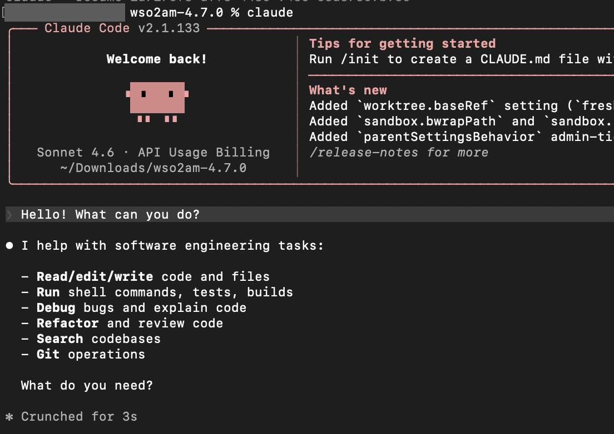

# Configure Claude Code with the AI Gateway

This guide explains how to configure Claude Code to send requests through Choreo AI Gateway using an AI Gateway and an Anthropic LLM Service Provider.

By routing requests through the AI Gateway instead of invoking Anthropic directly, you can apply security, traffic control, and governance policies such as guardrails and rate limiting. The AI Gateway acts as an intermediary, forwarding requests from Claude Code to Anthropic while enforcing these controls.

## Prerequisites

Before you begin, make sure you have:

- An [Anthropic API key](https://platform.claude.com/settings/keys)
- An Agent Control Plane account. [Sign up for free](https://console.cloud.choreolabs.com/agent-management/).
- Docker and Docker Compose, to run the self-hosted gateway
- [Claude Code](https://code.claude.com/docs/en/overview) installed

## Step 1: Start an AI Gateway in Agent Control Plane

:::note
If an AI Gateway is already created and active, continue to Step 2.
:::

:::tip
This step follows the same flow as the [Quick Start Guide](../../ai-gateway/self-hosted-gateways/quickstart-guide.mdx) for self-hosted gateways.
:::

If an AI Gateway is not already created, follow these steps:

1. In the left navigation menu, under **Infrastructure**, select **Gateways**.
2. Click **Add gateway**.
3. Enter the following values:

    | Field | Value |
    |---|---|
    | **Display Name** | My AI Gateway |
    | **Name** | `my-ai-gateway` |
    | **Environment** | Select your environment. |
    | **Public URL** | `https://localhost:8443` |

4. Click **Create**.

After you click **Create**, the Console shows a **Set up My AI Gateway** panel with four steps for the **Docker** tab. Run them on the machine that hosts the gateway:

1. Download and unzip the gateway package with the command that the panel shows.
2. Open the unzipped directory, and run `./scripts/setup.sh`. The script creates the listener certificate, the at-rest encryption key, and the `api-platform.env` file. It prints the admin password once, so copy it.
3. Click **Copy** next to the third step, and run the command. It appends the control plane host and your gateway token to `api-platform.env`.
4. Start the gateway with `docker compose up`.

:::warning
The Console shows the gateway token only once, when you create the gateway. Run the command in step 3 before you close the panel.
:::

:::note
If a default gateway port is already in use on your machine, edit the port mappings in the `docker-compose.yaml` file before you start the gateway, and use the same host port in the **Public URL**.
:::

**Expected result:** The **Gateways** page shows your gateway with the **Active** and **Self-hosted** labels.

The following image shows the **Gateways** page with the active self-hosted gateway:


Once the AI Gateway is active, you can continue to create the Anthropic LLM Service Provider.

## Step 2: Create and Deploy an Anthropic LLM Service Provider

1. In the left navigation menu, under **Resources**, select **LLM service providers**.
2. Click **Add service provider**.
3. Under **Basic Details**, enter the following values:

    | Field | Value |
    |---|---|
    | **Name** | Anthropic |
    | **Version** | v1.0 |
    | **Context path** | `/claudecode` |

4. Under **Provider Template**, select **Anthropic**.
5. Under **Runtime Configuration**, paste your Anthropic API key in **API key / Credential**.
6. Under **Deployment Configuration**, select the environment that your gateway belongs to. Open the gateway list that appears, and select **My AI Gateway**. The list defaults to the managed gateway, so change it.
7. Click **Add provider**.

**Expected result:** The provider page opens. The **Deployment** tab shows **My AI Gateway** with the **Deployed** status.

For more details on registering providers, see [Route LLM Traffic Through a Self-Hosted Gateway](../../ai-gateway/self-hosted-gateways/route-llm-traffic.mdx).

## Step 3: Generate an API Key for Claude Code

Claude Code needs an API key from the AI Gateway to invoke the deployed Anthropic LLM Service Provider.

1. On the provider page, open the **API Keys** tab.
2. Click **Create API key**.
3. Enter a **Display name**, and click **Create**.
4. Copy and save the generated API key. The Console shows it only once.

    Provide this API key to Claude Code in the `API-Key` custom header.

5. Open the **Overview** tab, and copy the **Invoke URL**.

You use these values when you configure Claude Code.

## Step 4: Configure Claude Code to Use the Anthropic LLM Service Provider

You can configure Claude Code with environment variables or with the Claude Code `settings.json` file.

### Configure Environment Variables

Open a terminal session where you want to run Claude Code.

Run the following commands, replacing the placeholders with your values:

```bash
export ANTHROPIC_BASE_URL="<INVOKE URL>"
export ANTHROPIC_AUTH_TOKEN="dummy-value"
export ANTHROPIC_CUSTOM_HEADERS="API-Key: <AI GATEWAY API KEY>"
```

Replace:

- `<INVOKE URL>` with the Invoke URL copied from the LLM Service Provider overview page
- `<AI GATEWAY API KEY>` with the API key generated for the LLM Service Provider

:::note
These environment variables apply only to the current terminal session. If you open a new terminal session, you must export them again.
:::

:::note Persistent Configuration
To make the configuration permanent, add the environment variables to the Claude Code `settings.json` file.

- **Location**: `~/.claude/settings.json`
- Create the file if it does not already exist.

```json
{
    "env": {
        "ANTHROPIC_BASE_URL": "<INVOKE URL>",
        "ANTHROPIC_AUTH_TOKEN": "dummy-value",
        "ANTHROPIC_CUSTOM_HEADERS": "API-Key: <AI GATEWAY API KEY>"
    }
}
```

For more information, see the [Claude Code settings documentation](https://code.claude.com/docs/en/settings).
:::

### Configure SSL Certificate Trust

When you use a local AI Gateway over HTTPS, Claude Code must trust the certificate that the gateway presents.

:::note
If the AI Gateway uses a valid CA-signed certificate, no additional certificate configuration is required.
:::

If the gateway uses a self-signed certificate, Claude Code can fail to connect because of certificate verification errors. In that case, extract the gateway certificate and point Node.js at it before you run the client:

1. Extract the certificate and save it as `gateway_certificate.pem` in the current directory.

   ```bash
   echo -n | openssl s_client -connect localhost:8443 2>/dev/null | sed -ne '/-BEGIN CERTIFICATE-/,/-END CERTIFICATE-/p' > gateway_certificate.pem
   ```

   If you changed the HTTPS host port of the gateway, use that port instead of `8443`.

2. Export the certificate path in the terminal where you run the client.

   ```bash
   export NODE_EXTRA_CA_CERTS="$PWD/gateway_certificate.pem"
   ```

For more information, see the [Claude Code TLS troubleshooting documentation](https://code.claude.com/docs/en/troubleshoot-install#tls-or-ssl-connection-errors).

To bypass SSL certificate validation during testing, run:

```bash
export NODE_TLS_REJECT_UNAUTHORIZED=0
```

## Step 5: Run Claude Code

After you set the required environment variables, run Claude Code:

```bash
claude
```

Claude Code now sends requests through the AI Gateway instead of calling Anthropic directly.

## Use Case Examples

### Implement AI Gateway Guardrails for Enhanced Control

AI Gateway guardrails enable granular control over the data exchanged between Claude Code and the Anthropic API.

By applying guardrails, you can enforce security and compliance policies such as:

- Input validation to ensure prompt integrity
- Output filtering to prevent leakage of sensitive data
- Rate limiting to control API usage and avoid cost overruns

For example, you can configure a PII Masking Regex policy on the provider's **Guardrails** tab to prevent Personally Identifiable Information (PII) from reaching the Anthropic API. If a user submits a prompt containing PII, the policy evaluates the request against defined patterns and redacts the matches before they reach the Anthropic API.

[](../../img/guides/ai-coding-assistants/configure-claude-code/claude-code-guardrail-redacted-example.png)

For more information on the PII Masking Regex policy, see the [Policy Hub](https://wso2.com/api-platform/policy-hub/policies/pii-masking-regex).

### Rate Limiting at the AI Gateway

The AI Gateway supports request-based and token-based rate limiting for LLM traffic. This lets you control Claude Code usage when requests are routed through the gateway.

For example, set a consumer-level token limit on the provider's **Rate Limiting** tab. Each developer's key then gets its own quota, and the gateway returns `HTTP 429` once a developer reaches it. For the steps, see [Enforce Token-Based Rate Limiting on an LLM Service Provider](../govern-llm-traffic/enforce-token-based-rate-limiting.mdx).

This helps control token consumption and avoid unexpected costs.

[](../../img/guides/ai-coding-assistants/configure-claude-code/claude-code-rate-limit-example.png)

### Prompt Decorator

The AI Gateway supports the Prompt Decorator policy, which lets you modify or enrich prompts before the gateway sends them to the backend AI provider. This is useful for enforcing consistent instructions, adding system-level context, or guiding model behavior without requiring changes in the client application. For a full walkthrough, see [Enforce a Consistent AI Persona](../govern-llm-traffic/enforce-a-consistent-ai-persona.mdx).

As an example, you can configure a Prompt Decorator on the provider's **Guardrails** tab to append an instruction to all incoming prompts.

The following screenshot shows Claude Code responding to a prompt with no Prompt Decorator.

[](../../img/guides/ai-coding-assistants/configure-claude-code/claude-code-prompt-decorator-example.png)

The following screenshot shows Claude Code responding to that same prompt with a Prompt Decorator configured to append the following decoration: "Be very concise. Use as little words as possible when answering."

[](../../img/guides/ai-coding-assistants/configure-claude-code/claude-code-prompt-decorator-example-2.png)

For more information on the Prompt Decorator policy, see the [Policy Hub](https://wso2.com/api-platform/policy-hub/policies/prompt-decorator).
