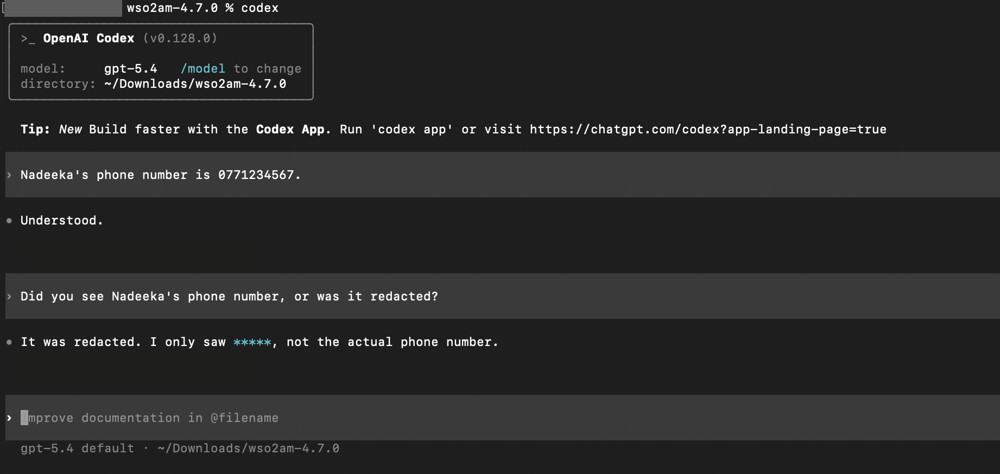
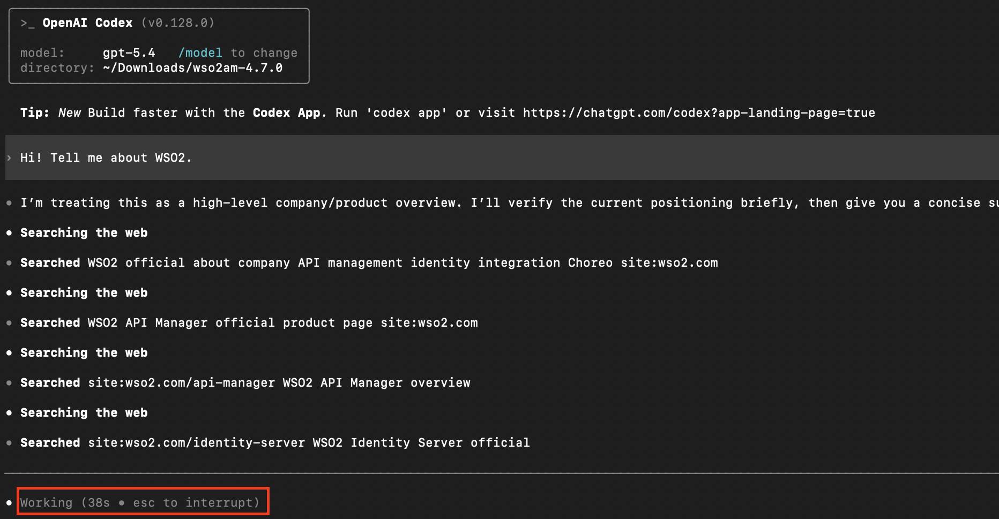
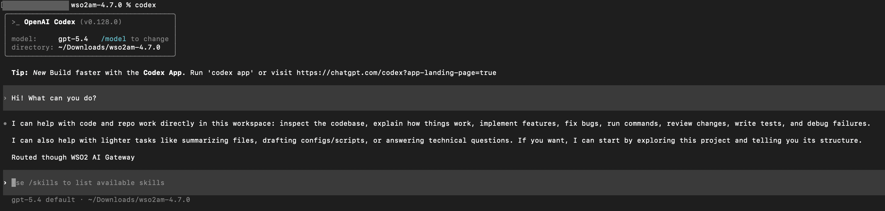

import Tabs from '@theme/Tabs';
import TabItem from '@theme/TabItem';

# Configure OpenAI Codex CLI with the AI Gateway

This guide explains how to configure OpenAI Codex CLI to send requests through Choreo AI Gateway using an AI Gateway and an OpenAI LLM Service Provider.

By routing requests through the AI Gateway instead of invoking OpenAI directly, you can apply security, traffic control, and governance policies such as guardrails and rate limiting. The AI Gateway acts as an intermediary, forwarding requests from Codex CLI to OpenAI while enforcing these controls.

## Prerequisites

Before you begin, make sure you have:

- [OpenAI Codex CLI](https://developers.openai.com/codex/cli) installed
- An [OpenAI API key](https://platform.openai.com/api-keys)
- An Agent Control Plane account. [Sign up for free](https://console.cloud.choreolabs.com/agent-management/).
- Docker and Docker Compose, to run the self-hosted gateway

## Step 1: Start an AI Gateway in Agent Control Plane

:::note
If an AI Gateway is already created and active, continue to Step 2.
:::

:::tip
This step follows the same flow as the [Quick Start Guide](../../ai-gateway/self-hosted-gateways/quickstart-guide.mdx) for self-hosted gateways.
:::

If an AI Gateway is not already created, follow these steps:

1. In the left navigation menu, under **Infrastructure**, select **Gateways**.
2. Click **Add gateway**.
3. Enter the following values:

    | Field | Value |
    |---|---|
    | **Display Name** | My AI Gateway |
    | **Name** | `my-ai-gateway` |
    | **Environment** | Select your environment. |
    | **Public URL** | `https://localhost:8443` |

4. Click **Create**.

After you click **Create**, the Console shows a **Set up My AI Gateway** panel with four steps for the **Docker** tab. Run them on the machine that hosts the gateway:

1. Download and unzip the gateway package with the command that the panel shows.
2. Open the unzipped directory, and run `./scripts/setup.sh`. The script creates the listener certificate, the at-rest encryption key, and the `api-platform.env` file. It prints the admin password once, so copy it.
3. Click **Copy** next to the third step, and run the command. It appends the control plane host and your gateway token to `api-platform.env`.
4. Start the gateway with `docker compose up`.

:::warning
The Console shows the gateway token only once, when you create the gateway. Run the command in step 3 before you close the panel.
:::

:::note
If a default gateway port is already in use on your machine, edit the port mappings in the `docker-compose.yaml` file before you start the gateway, and use the same host port in the **Public URL**.
:::

**Expected result:** The **Gateways** page shows your gateway with the **Active** and **Self-hosted** labels.

The following image shows the **Gateways** page with the active self-hosted gateway:


Once the AI Gateway is active, you can continue to create the OpenAI LLM Service Provider.

## Step 2: Create and Deploy an OpenAI LLM Service Provider

1. In the left navigation menu, under **Resources**, select **LLM service providers**.
2. Click **Add service provider**.
3. Under **Basic Details**, enter the following values:

    | Field | Value |
    |---|---|
    | **Name** | OpenAI Codex |
    | **Version** | v1.0 |
    | **Context path** | `/codexcli` |

    :::note
    The Console builds the provider ID from the name, so each provider in an organization needs a different name. If you already created a provider named `OpenAI`, use another name, such as `OpenAI Codex`.
    :::

4. Under **Provider Template**, select **OpenAI**.
5. Under **Runtime Configuration**, paste your OpenAI API key in **API key / Credential**.
6. Under **Deployment Configuration**, select the environment that your gateway belongs to. Open the gateway list that appears, and select **My AI Gateway**. The list defaults to the managed gateway, so change it.
7. Click **Add provider**.

**Expected result:** The provider page opens. The **Deployment** tab shows **My AI Gateway** with the **Deployed** status.

For more details on registering providers, see [Route LLM Traffic Through a Self-Hosted Gateway](../../ai-gateway/self-hosted-gateways/route-llm-traffic.mdx).

## Step 3: Generate an API Key for Codex CLI

Codex CLI needs an API key from the AI Gateway to invoke the deployed OpenAI LLM Service Provider.

1. On the provider page, open the **API Keys** tab.
2. Click **Create API key**.
3. Enter a **Display name**, and click **Create**.
4. Copy and save the generated API key. The Console shows it only once.

    Provide this API key to Codex CLI in the `API-Key` custom header.

5. Open the **Overview** tab, and copy the **Invoke URL**.

You use these values when you configure Codex CLI.

## Step 4: Configure Codex CLI to Use the OpenAI LLM Service Provider

You can configure Codex CLI to use a custom OpenAI-compatible provider by updating its `config.toml` file.

1. Open the Codex CLI configuration file located at:

    ```bash
    ~/.codex/config.toml
    ```

    If the file does not already exist, create it:

    ```bash
    mkdir -p ~/.codex
    touch ~/.codex/config.toml
    ```

2. Add the following configuration to `~/.codex/config.toml`, replacing the `base_url` with the Invoke URL copied from the LLM Service Provider overview page:

    ```toml
    model = "gpt-5.4"
    model_provider = "openaicustom"

    [model_providers.openaicustom]
    name = "CHOREO OPEN AI PROVIDER"
    base_url = "<INVOKE URL>"
    env_key = "OPENAI_AUTH_TOKEN"
    wire_api = "responses"
    env_http_headers = { "API-Key" = "OPENAI_AUTH_TOKEN" }
    ```

    This configuration instructs Codex CLI to use the LLM Service Provider endpoint and to send the AI Gateway API key in the `API-Key` header.

### Configure Environment Variables for Codex CLI

1. Open a terminal session where you want to run Codex CLI.

2. Export the API key generated in the Console:

    ```bash
    export OPENAI_AUTH_TOKEN="<AI GATEWAY API KEY>"
    ```

    Replace `<AI GATEWAY API KEY>` with the API key generated for the LLM Service Provider.

:::note
Set this environment variable in the same terminal session where you run Codex CLI. Alternatively, you can configure it as a permanent environment variable.
:::

## Step 5: Configure the Gateway Certificate for Codex CLI

When you use a local AI Gateway over HTTPS, Codex CLI must trust the certificate that the gateway presents.

:::note
If the AI Gateway uses a valid CA-signed certificate, no additional certificate configuration is required.
:::

If the gateway uses a self-signed certificate, Codex CLI fails to connect because of certificate verification errors. In that case, add the gateway certificate to your operating system's trust store before you run the client.

1. Extract the gateway certificate and save it as `gateway_certificate.pem` in the current directory.

   ```bash
   echo -n | openssl s_client -connect localhost:8443 2>/dev/null | sed -ne '/-BEGIN CERTIFICATE-/,/-END CERTIFICATE-/p' > gateway_certificate.pem
   ```

   On Windows, run this command in Git Bash.

2. Add the certificate to your operating system's trust store.

   <Tabs>
     <TabItem value="macos" label="macOS" default>

   ```bash
   security add-trusted-cert -r trustRoot -k ~/Library/Keychains/login.keychain-db gateway_certificate.pem
   ```

     </TabItem>
     <TabItem value="linux" label="Linux (Ubuntu or Debian)">

   ```bash
   sudo cp gateway_certificate.pem /usr/local/share/ca-certificates/gateway_certificate.crt
   sudo update-ca-certificates
   ```

     </TabItem>
     <TabItem value="windows" label="Windows (PowerShell)">

   ```powershell
   certutil -user -addstore Root gateway_certificate.pem
   ```

     </TabItem>
   </Tabs>

3. Open a new terminal window before you run Codex CLI.

:::warning SSL_CERT_FILE Does Not Work with the Default Certificate
Codex CLI rejects the self-signed certificate that the local AI Gateway generates when you pass it through `SSL_CERT_FILE`, and then repeats `Reconnecting... waiting for network`. Add the certificate to the operating system's trust store instead, and do not set `SSL_CERT_FILE`.
:::

:::note Local Testing Only
For local testing only, you can use the HTTP endpoint of the gateway instead of the Invoke URL, for example `http://localhost:8080/<PROVIDER CONTEXT PATH>`. Do not use HTTP in production, because the API key and prompts are sent unencrypted.
:::

## Step 6: Run the Codex CLI Client

Run Codex CLI:

```bash
codex
```

Requests now route through the AI Gateway.

## Use Case Examples

### Implement AI Gateway Guardrails for Enhanced Control

AI Gateway guardrails enable granular control over the data exchanged between Codex CLI and the OpenAI API.

By applying guardrails, you can enforce security and compliance policies.

For example, you can configure a PII Masking Regex policy on the provider's **Guardrails** tab to prevent Personally Identifiable Information (PII) from reaching the OpenAI API. If a user submits a prompt containing PII, the policy evaluates the request against defined patterns and redacts the matches before they reach the OpenAI API.

[](../../img/guides/ai-coding-assistants/configure-codex-cli/codex-guardrail-redacted-example.png)

For more information on the PII Masking Regex policy, see the [Policy Hub](https://wso2.com/api-platform/policy-hub/policies/pii-masking-regex).

### Rate Limiting at the AI Gateway

The AI Gateway supports request-based and token-based rate limiting for LLM traffic. This lets you control Codex CLI usage when requests are routed through the gateway.

For example, set a consumer-level token limit on the provider's **Rate Limiting** tab. Each developer's key then gets its own quota, and the gateway returns `HTTP 429` once a developer reaches it. For the steps, see [Enforce Token-Based Rate Limiting on an LLM Service Provider](../govern-llm-traffic/enforce-token-based-rate-limiting.mdx).

This helps control token consumption and avoid unexpected costs.

The following screenshot illustrates Codex CLI operating under a configured AI Gateway rate limit.

[](../../img/guides/ai-coding-assistants/configure-codex-cli/codex-rate-limit-example.png)

### Prompt Decorator

The AI Gateway supports the Prompt Decorator policy, which lets you modify or enrich prompts before the gateway sends them to the backend AI provider. This is useful for enforcing consistent instructions, adding system-level context, or guiding model behavior without requiring changes in the client application. For a full walkthrough, see [Enforce a Consistent AI Persona](../govern-llm-traffic/enforce-a-consistent-ai-persona.mdx).

As an example, you can configure a Prompt Decorator on the provider's **Guardrails** tab to prepend a system instruction to all incoming prompts:

```text
You are operating behind an enterprise AI gateway. Follow these rules:
1. Be concise and direct.
2. Never output secrets, tokens, or credentials.
3. When editing code, explain the change briefly.
4. When unsure, state the assumption explicitly.
5. At the end of every response, add the text: 'Routed through WSO2 AI Gateway'.
```

Once configured, the gateway automatically modifies every request that Codex CLI sends to include this instruction before forwarding it to OpenAI.

[](../../img/guides/ai-coding-assistants/configure-codex-cli/codex-prompt-decorator-example.png)

For more information on the Prompt Decorator policy, see the [Policy Hub](https://wso2.com/api-platform/policy-hub/policies/prompt-decorator).
