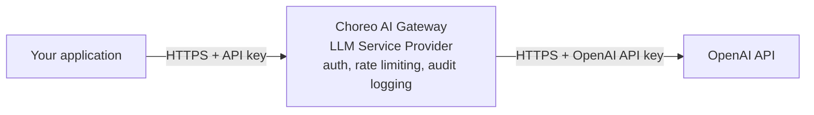
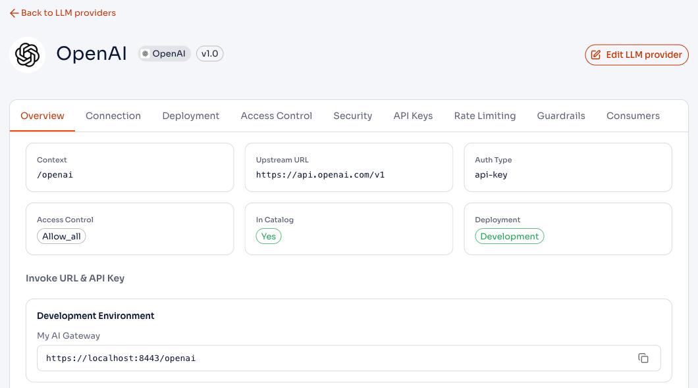
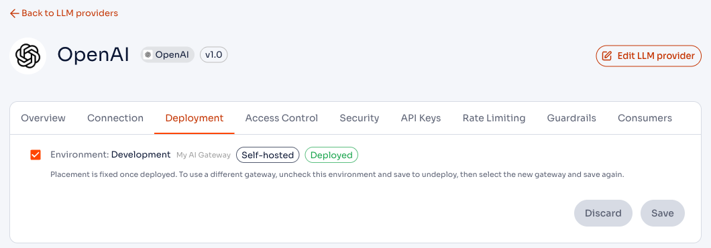
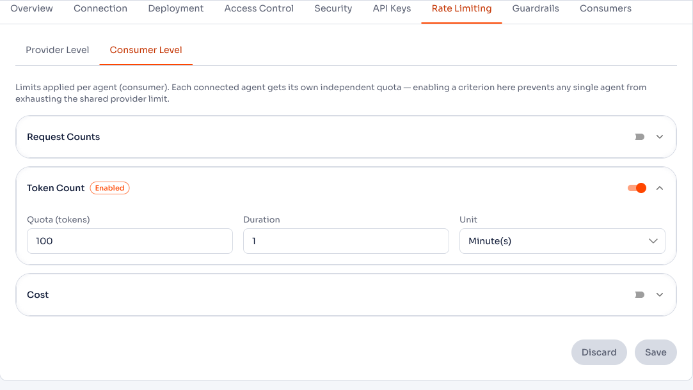

# Enforce Token-Based Rate Limiting on an LLM Service Provider

This guide shows you how to put a token quota on an LLM Service Provider so no single application can exhaust your OpenAI budget in a burst. Without a quota, any caller can drain your token allowance before you notice, and your provider rate limits apply without warning. By the end, you have a live LLM Service Provider that blocks further requests with `HTTP 429` once the quota is reached. A companion sample is available to run locally and verify the same behavior without real credentials.

## Learning Objectives

- Register an OpenAI LLM Service Provider so the gateway holds the API key and your applications do not.
- Attach a consumer-level token limit that caps token consumption within a rolling time window.
- Create an API key that your applications use to call the provider through the gateway.
- Verify that the gateway enforces the quota and returns `HTTP 429` once the limit is reached.

## Prerequisites

- An Agent Control Plane account. [Sign up for free](https://console.cloud.choreolabs.com/agent-management/).
- Docker and Docker Compose, to run the self-hosted AI Gateway.
- An OpenAI API key.
- `curl` for testing.

## Architecture



The LLM Service Provider is deployed on the Choreo AI Gateway, which sits between your application and OpenAI. The AI Gateway authenticates incoming requests using an API key, tracks token consumption from each OpenAI response, and blocks new requests once the configured quota is reached within the time window. Your application never holds the OpenAI API key.

## Step 1: Create and Start an AI Gateway

The AI Gateway is the runtime that hosts your provider and enforces your limits. If you already have a gateway running and shown as **Active** in the Console, skip this step and proceed to Step 2.

:::tip
For the same gateway setup flow with more detail, see the [Quick Start Guide](../../ai-gateway/self-hosted-gateways/quickstart-guide.mdx).
:::

**Create the gateway:**

1. In the left navigation menu, under **Infrastructure**, click **Gateways**.
2. Click **Add gateway**.
3. Enter the following details:

    | Field | Value |
    |---|---|
    | **Display Name** | My AI Gateway |
    | **Name** | `my-ai-gateway` |
    | **Environment** | Select your environment. |
    | **Public URL** | `https://localhost:8443` |

4. Click **Create**.

:::warning
The Console shows the gateway token only once, when you create the gateway. Run the command in step 3 of the setup panel before you close it.
:::

**Start the gateway runtime:**

After you click **Create**, the Console shows a **Set up My AI Gateway** panel with four steps for the **Docker** tab. Run them on the machine that hosts the gateway:

1. Download and unzip the gateway package with the command that the panel shows.
2. Open the unzipped directory, and run `./scripts/setup.sh`. The script creates the listener certificate, the at-rest encryption key, and the `api-platform.env` file. It prints the admin password once, so copy it.
3. Click **Copy** next to the third step, and run the command. It appends the control plane host and your gateway token to `api-platform.env`.
4. Start the gateway with `docker compose up`.

:::note
If a default gateway port is already in use on your machine, edit the port mappings in the `docker-compose.yaml` file before you start the gateway, and use the same host port in the **Public URL**.
:::

**Expected result:** The **Gateways** page shows your gateway with the **Active** and **Self-hosted** labels.


## Step 2: Add OpenAI as an LLM Service Provider

Registering the provider stores your OpenAI API key in the platform. Your application never handles the key directly. The gateway uses it to authenticate with OpenAI on every request. For more about this resource, see [LLM Service Providers](../../agent-control-plane/administer/llm-service-providers.mdx).

1. In the left navigation menu, under **Resources**, click **LLM service providers**.
2. Click **Add service provider**.
3. Under **Basic Details**, enter the following details:

    | Field | Value |
    |---|---|
    | **Name** | OpenAI |
    | **Version** | v1.0 |
    | **Context path** | `/openai` |

    :::note
    The Console builds the provider ID from the name, so each provider in an organization needs a different name. If you already created a provider named `OpenAI`, use another name, such as `OpenAI Rate Limit`.
    :::

4. Under **Provider Template**, select **OpenAI**.
5. Under **Runtime Configuration**, confirm that **Endpoint URL** is `https://api.openai.com/v1`.
6. In **API key / Credential**, paste your OpenAI API key.
7. Under **Deployment Configuration**, select the environment that your gateway belongs to. Open the gateway list that appears, and select **My AI Gateway**. The list defaults to the managed gateway, so change it. **Add provider** stays unavailable until you select an environment.
8. Click **Add provider**.

**Expected result:** The provider page opens, and **OpenAI** appears in the **LLM service providers** list.



## Step 3: Check the Deployment

Adding the provider with a gateway selected pushes its configuration to the gateway runtime.

1. On the provider page, open the **Deployment** tab.
2. Check the status next to your gateway.

**Expected result:** The **Deployment** tab shows **My AI Gateway** with the **Deployed** status.



:::note
A provider deploys to one gateway for each environment. To move a deployed provider to a different gateway, clear the environment, click **Save**, select the new gateway, and click **Save** again.
:::

## Step 4: Add a Consumer-Level Token Limit

This limit reads the token count from each OpenAI response and blocks further requests once the configured total is reached within the time window. A consumer-level limit gives each application that calls the provider its own independent quota.

1. On the provider page, open the **Rate Limiting** tab.
2. Click the **Consumer Level** sub-tab.
3. Expand **Token Count**, and then turn on its switch.
4. Set the following values:

    | Field | Value |
    |---|-------|
    | **Quota (tokens)** | `100` |
    | **Duration** | `1` |
    | **Unit** | `Minute(s)` |

5. Click **Save**.

**Expected result:** The Console displays **Rate limits updated successfully.** and **Token Count** shows **Enabled**.



:::tip
A quota of 100 tokens per minute is intentionally low for testing. It makes the `429` easy to trigger. For production workloads, set **Quota (tokens)** to match your actual per-application budget, for example `100000` for 100,000 tokens per minute.
:::

:::note
To cap the combined usage of all applications instead, use the **Provider Level** sub-tab. You can also set limits on **Request Counts** and **Cost**.
:::

## Step 5: Generate an API Key

Your application uses this key to authenticate with the gateway. The gateway validates the key before forwarding any request to OpenAI.

1. On the provider page, open the **API Keys** tab.
2. Click **Create API key**.
3. Enter a **Display name** (for example, `test-key`), and click **Create**.
4. Copy the key immediately. The Console shows it only once.
5. Open the **Overview** tab, and copy the **Invoke URL** from the **Invoke URL & API Key** section.

**Expected result:** The API key and invoke URL are ready to use.

## Verify

Use the API key and invoke URL from Step 5 for all requests below. The invoke URL is your gateway Public URL followed by the provider context path, for example `https://localhost:8443/openai`. The provider reads the key from the `API-Key` header.

1. Send a request to the provider:

    ```bash
    curl -ik -X POST <INVOKE-URL>/chat/completions \
      -H "API-Key: <YOUR-API-KEY>" \
      -H "Content-Type: application/json" \
      -d '{
        "model": "gpt-4o-mini",
        "messages": [{"role": "user", "content": "What is the capital of France?"}]
      }'
    ```

    **Expected result:** `HTTP 200` with an OpenAI response. Check the response headers. `x-ratelimit-remaining` shows your remaining token budget for the current window.

2. Repeat the request until the response is `HTTP 429`. Each short request uses about 20 tokens, so this takes about five to six requests.

    **Expected result:** `HTTP 429 Too Many Requests` with the message `Rate limit exceeded. Please try again later.` The `x-ratelimit-reset` header shows the epoch time when the window resets and new requests are accepted.

3. Send a request without an API key:

    ```bash
    curl -k -X POST <INVOKE-URL>/chat/completions \
      -H "Content-Type: application/json" \
      -d '{
        "model": "gpt-4o-mini",
        "messages": [{"role": "user", "content": "Hello"}]
      }'
    ```

    **Expected result:** `HTTP 401 Unauthorized` with the message `Valid API key required`. Unauthenticated requests are rejected before reaching OpenAI.

:::note
The gateway counts tokens from each OpenAI response. The request that crosses the limit can still succeed, and the following requests receive the `429`.
:::

For the general request flow through a self-hosted gateway, see [Route LLM Traffic](../../ai-gateway/self-hosted-gateways/route-llm-traffic.mdx).

## Troubleshooting

| Symptom | Resolution |
|---|---|
| `HTTP 401 Unauthorized` on every request | Confirm the `API-Key` header is present and matches the key generated in Step 5. |
| `HTTP 429` on the first request | The token quota is already exhausted from a previous test run. Wait for the 1-minute window to reset, then retry. The `x-ratelimit-reset` header shows when the window resets. |
| Provider not reachable after deployment | Confirm the gateway shows **Active** on the **Gateways** page and the **Deployment** tab shows **Deployed**. |
| Rate limit not enforced after configuration | Confirm **Token Count** shows **Enabled** on the **Consumer Level** sub-tab and that you clicked **Save**. |
| Provider connection failing | Confirm your OpenAI API key is valid and has not expired. Go to **LLM service providers**, open **OpenAI**, and check the **Connection** tab. |

## What You Learned

- Registered an OpenAI LLM Service Provider so the gateway manages the API key and your applications never handle it directly.
- Attached a consumer-level token limit that caps token consumption within a rolling time window.
- Generated an API key for applications to call the provider through the gateway.
- Verified that the gateway returns `HTTP 429` once the quota is exhausted and `HTTP 401` for unauthenticated requests.

## Next Steps

- [Set up a multi-model LLM Service Provider](./set-up-a-multi-model-llm-service-provider.mdx): extend this provider with model round-robin distribution, PII masking, and semantic caching.
- [Token-based rate limit policy reference](https://wso2.com/api-platform/policy-hub/policies/token-based-ratelimit): configure separate limits for prompt tokens, completion tokens, and total tokens independently.
- [LLM cost-based rate limiting](https://wso2.com/api-platform/policy-hub/policies/llm-cost-based-ratelimit): enforce a monetary spending budget instead of a token count.

## Try the Sample

The companion sample runs this setup end to end using Docker, with a mock OpenAI backend and a pre-configured token-based rate limit policy. No real API credentials are required.

[View the sample on GitHub](https://github.com/wso2/api-platform/tree/main/samples/ai-gw-llm-proxy)
