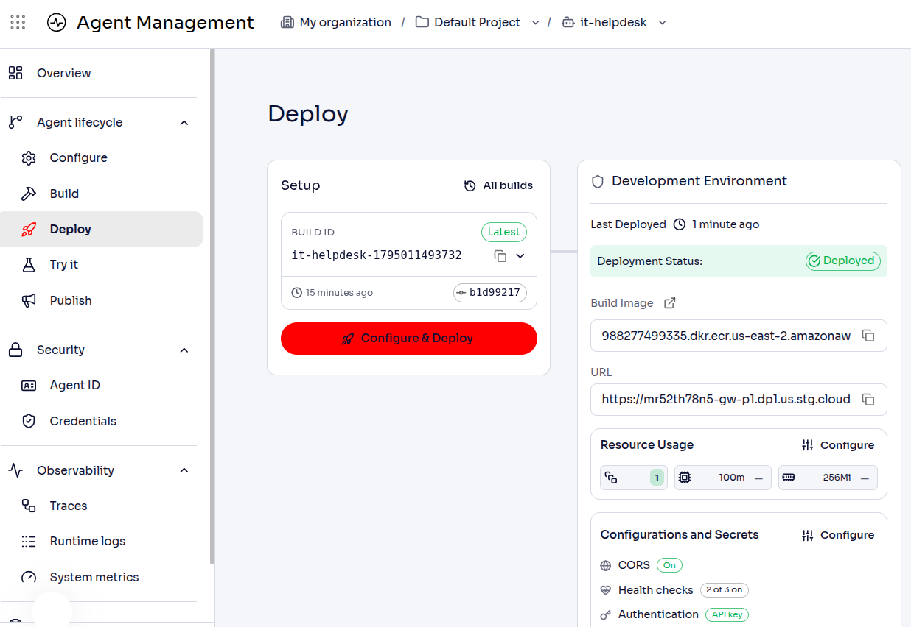

# Quick Start Guide

WSO2 Agent Manager Cloud deploys, governs, and observes AI agents at scale. You can, for example, give it an agent's source code. Agent Manager then builds the agent, runs it, and records a trace of every request.

This quick start guides you through the following tasks:

- [Part 1: Sign In and Open Your Project](#part-1-sign-in-and-open-your-project)
- [Part 2: Deploy the Sample Agent](#part-2-deploy-the-sample-agent)
- [Part 3: Chat with the Agent](#part-3-chat-with-the-agent)
- [Part 4: Inspect the Trace](#part-4-inspect-the-trace)

It's intended for developers who build AI agents and want to run one on Agent Manager Cloud. It assumes that you have basic knowledge of the following:

- AI agents and how they call large language models (LLMs)
- [Projects](./concepts/project.mdx)
- [Platform-hosted agents](./concepts/internal-and-external-agent.mdx)
- [Traces](./concepts/observability.mdx)

You deploy the [`it-helpdesk-agent`](https://github.com/wso2/agent-manager/tree/main/samples/it-helpdesk-agent) sample, an IT support agent for a fictional company called AcmeCorp. It's a LangGraph agent served by FastAPI. Its tools work on mock employee data. You don't write or change any code.

## Before You Start

Before running this quick start, make sure you have the following:

- A Google or GitHub account to sign in with.
- An OpenAI API key, which you create in your OpenAI account. The sample agent uses it to call the model.

## Part 1: Sign In and Open Your Project

In this part, you sign in to the Console and open the project that holds your agent.

### Step 1.1: Sign In to the Console

In your browser, go to the [Agent Manager Console](https://console.cloud.choreolabs.com/agent-management/) and sign in with your Google or GitHub account. 

The Console opens. If you don't belong to an organization yet, it prompts you to create one.

### Step 1.2: Create an Organization

If you already belong to an [organization](./concepts/organization.mdx), skip to [Part 2](#part-2-deploy-the-sample-agent).

Otherwise, enter a name for the organization and a handle. The handle is a short, URL-safe identifier of your organization. Then click __Create organization__.

The Console opens inside the organization's __default__ project. You deploy the agent into this project.

## Part 2: Deploy the Sample Agent

In this part, you create a platform-hosted agent from the sample's GitHub folder. Agent Manager builds the agent, deploys it to your first environment, and adds tracing.

### Step 2.1: Open the Add a New Agent Page

In the __default__ project, open the __Add a new agent__ page. If the project has no agents, the Console opens this page for you. Otherwise, in the navigation menu, click __Agents__, and then click __New agent__.

The page asks you to choose the type of agent to deploy.

### Step 2.2: Select a Platform-Hosted Agent

On the __Add a new agent__ page, select __Platform-hosted agent__, then select __Source code__ as the source type.

### Step 2.3: Enter the Repository Details

On the same form, point the agent at the sample's folder in GitHub by entering the following details. The repository is public.

| Field | Value |
|---|---|
| __Name__ | `it-helpdesk` |
| __GitHub repository__ | `https://github.com/wso2/agent-manager` |
| __Branch__ | `main` |
| __Project path__ | `/samples/it-helpdesk-agent` |

### Step 2.4: Configure the Python Build

On the same form, configure the agent to build and run as a Python app with tracing turned on:

1. Select __Python__ as the build type.
2. In the __Start command__ field, keep the default, `python main.py`.
3. In the __Language version__ list, select `3.11` or later.
4. Keep auto instrumentation turned on, with the default __AMP instrumentation version__.

Auto instrumentation makes the agent send traces to Agent Manager without any tracing code in the sample. Both the __Auto instrumentation__ toggle and the version are already set the way the sample needs.

### Step 2.5: Select the Chat Agent Type

On the same form, for __Agent type__, select __Chat agent__. The sample serves the chat interface in the Console so you can talk to the agent.

### Step 2.6: Add Your OpenAI API Key

On the same form, in __Environment variables__, add the following variable and mark it as a secret:

| Key | Value | Secret |
|---|---|---|
| `OPENAI_API_KEY` | Your OpenAI API key | Yes |

Leave every other setting at its default.

### Step 2.7: Deploy the Agent

To create the agent and start the build, click __Create and deploy__.

The build process starts and the Console opens the agent's overview page. The first build takes a few minutes. When the build completes, Agent Manager deploys the agent to your first environment.

### Step 2.8: Check the Deployment Status

On the agent's page, in the __Agent lifecycle__ section of the navigation menu, click __Deploy__.

When the agent is ready to receive messages, the card for your first environment shows the deployment status as __Deployed__:



## Part 3: Chat with the Agent

In this part, you send messages to the agent. You check that the agent follows a rule: verify the employee's identity before resetting a password.

### Step 3.1: Open Try It

On the agent's page, in the __Agent lifecycle__ section of the navigation menu, click __Try it__.

A chat window opens. Messages you send here go to your deployed agent.

### Step 3.2: Request a Password Reset

In the chat window, send the following message:

```text
Hi, I forgot my password and need it reset.
```

The agent asks you to verify your identity instead of resetting anything.

### Step 3.3: Verify Your Identity

In the same chat window, send the details of a test employee from the sample's mock data:

```text
My email is alice.chen@acmecorp.com and my employee ID is E-1001.
```

The agent verifies the employee's identity and continues with the password reset. The chat interface keeps the same session while the page stays open, so the agent remembers your earlier message.

## Part 4: Inspect the Trace

In this part, you open the trace for your last message. You see the steps the agent took to answer it and the messages it sent to the model.

### Step 4.1: Open the Traces Page

On the agent's page, in the __Observability__ section of the navigation menu, click __Traces__.

The page lists the traces your agent has produced.

### Step 4.2: Open the Latest Trace

In the list, click the most recent trace.

The trace shows the request as a tree of spans, one per operation, with the duration of each span. The tree includes the following spans:

- `POST /chat`: the root span, which covers the whole request. Its details show the end-to-end duration and if the request completed successfully.
- `ChatOpenAI.chat`: a call to the model. Its details include the model name and the number of tokens the call used.
- `execute_tool` followed by a tool name: a tool the agent executed. Its details include the tool's input and output.

### Step 4.3: Find the Identity Check

In the span tree, click the `execute_tool verify_identity` span.

The span appears before the `execute_tool reset_password` span, so the agent checked the employee's identity before resetting the password. On the __Overview__ tab, the span shows what the tool received and returned:

- __Input messages:__ the email address and employee ID you sent in [Step 3.3](#step-33-verify-your-identity).
- __Output messages:__ Alice Chen's employee record, with `verified` set to `true`.

### Step 4.4: See What the Agent Sent to the Model

To see the messages behind the first model call, click the first `ChatOpenAI.chat` span in the tree.

On the __Overview__ tab, the __Input messages__ section lists what the agent sent to the model:

- __System:__ the agent's instructions. Its `IDENTITY FIRST` rule tells the agent to verify the employee's identity before a password reset.
- __User__ and __Assistant:__ your first message and the agent's reply, followed by your second message.

The agent sends the conversation so far with every model call. That's how it remembered your first message in [Step 3.3](#step-33-verify-your-identity).

## Next Steps

After completing this quick start, continue with the tutorial series. It builds on the same agent and adds governance one layer at a time:

- [Add guardrails to your agent](./tutorials/govern-the-model.mdx): route the agent's model calls through a gateway that enforces guardrails and rate limits.
- [Connect your agent to real tools](./tutorials/give-the-agent-real-tools.mdx): give the agent a governed Model Context Protocol (MCP) server and limit which tools it can call.
- [Monitor Your Agent](./tutorials/observe-first-agent.mdx): score the agent's behavior automatically with evaluators.
- [Ship the agent to Production](./tutorials/promote-your-agent.mdx): promote the agent through environments. 

## See Also

- [Secure Agent Endpoints with API Keys](./guides/secure-agent-endpoints-with-api-keys.mdx): call your agent from outside the Console.
- [AMP Instrumentation](./guides/amp-instrumentation.mdx): trace an agent that runs on your own infrastructure.
- [Observability](./concepts/observability.mdx): how Agent Manager collects and shows traces.
- [Internal and External Agent](./concepts/internal-and-external-agent.mdx): when to let Agent Manager run your agent and when to host it yourself.
