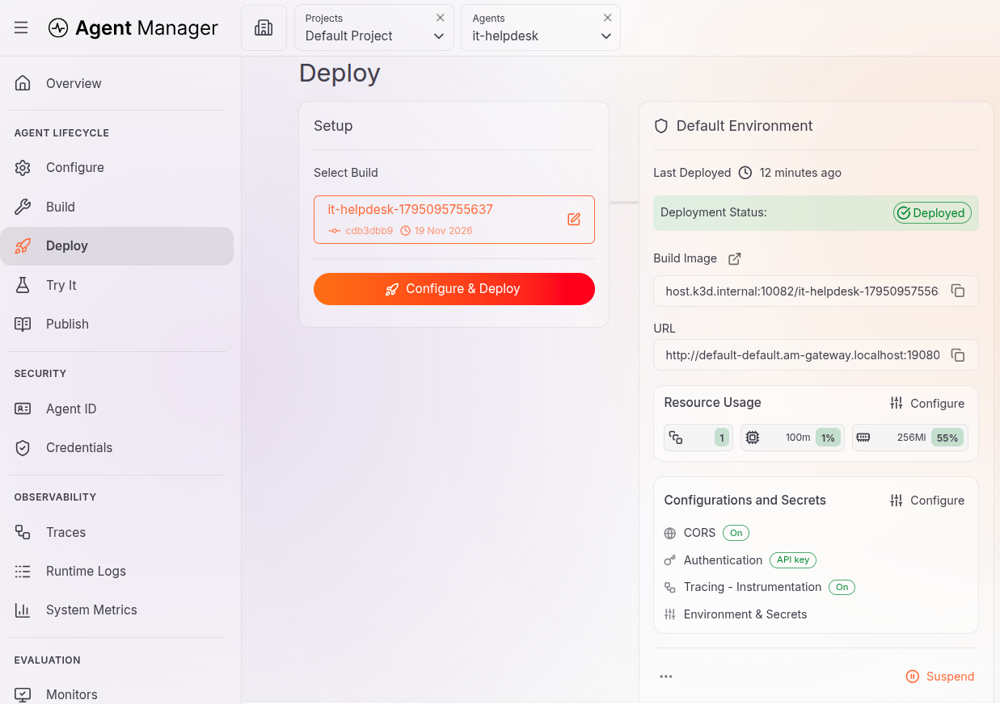

import Tabs from '@theme/Tabs';
import TabItem from '@theme/TabItem';

# Quick Start Guide

WSO2 Agent Manager deploys, governs, and observes AI agents at scale. You can, for example, give it an agent's source code. Agent Manager then builds the agent, runs it, and records a trace of every request.

This quick start guides you through the following tasks:

- [Part 1: Install Agent Manager](#part-1-install-agent-manager)
- [Part 2: Sign In and Open Your Project](#part-2-sign-in-and-open-your-project)
- [Part 3: Deploy the Sample Agent](#part-3-deploy-the-sample-agent)
- [Part 4: Chat with the Agent](#part-4-chat-with-the-agent)
- [Part 5: Inspect the Trace](#part-5-inspect-the-trace)

It's intended for developers who build AI agents and want to run Agent Manager on their own machine. It assumes that you have basic knowledge of the following:

- Docker and running commands in a terminal
- AI agents and how they call large language models (LLMs)
- [Projects](../concepts/project.mdx)
- [Platform-hosted agents](../concepts/internal-and-external-agent.mdx)
- [Traces](../concepts/observability.mdx)

You deploy the [`it-helpdesk-agent`](https://github.com/wso2/agent-manager/tree/main/samples/it-helpdesk-agent) sample, an IT support agent for a fictional company called AcmeCorp. It's a LangGraph agent served by FastAPI. Its tools work on mock employee data. You don't write or change any code.

:::info Stronger agent isolation tiers
Agents run sandboxed under the standard **runc** runtime by default. Agent Manager also supports stronger per-environment isolation tiers — **gVisor** (userspace kernel) and **Kata Containers** (per-agent VM) — but they have hardware/OS requirements and need a dedicated node. For more information, see the [gVisor](../guides/isolation-tiers/gvisor.mdx) and [Kata Containers](../guides/isolation-tiers/kata.mdx) setup guides.
:::

## Before You Start

Before running this quick start, make sure you have the following:

- Docker, with at least 8 GB of RAM and 4 CPUs allocated. Docker Engine 26.0 or later is recommended.
- An OpenAI API key, which you create in your OpenAI account. The sample agent uses it to call the model.

If you use a Mac, Colima gives the best compatibility. To use it, start an `agent-manager` profile with the necessary installation resources:

```sh
colima start --profile agent-manager \
    --vm-type=vz --vz-rosetta --network-address \
    --cpu 4 --memory 8
```

The `agent-manager` profile isolates this installation from your default Colima instance. The `--network-address` option gives the VM a stable IP address so the cluster keeps working despite network changes.

:::warning Set the VM size before you install, not after
Changing `--cpu` or `--memory` later requires restarting the Colima VM, which rebuilds the Docker networks underneath the `amp-local` cluster. The k3d server container can then crash-loop on every boot instead of starting, and `kubectl` stops responding. Recovering means deleting and recreating the cluster, so it is worth allocating enough up front. The [k3d installation guide](../guides/on-k3d.mdx#troubleshooting) has the recovery steps.
:::

## Part 1: Install Agent Manager

In this part, you start a dev container that has every installation tool in it, and you run the installer from inside it. The installer creates a local Kubernetes cluster and installs Agent Manager, its Console, and its observability stack.

### Step 1.1: Start the Dev Container

Start the dev container in one of the following ways. The `start.sh` script first checks that Docker is installed and running, that you have enough free disk space, and that your CPU architecture is supported.

<Tabs groupId="quick-start-container">
<TabItem value="script" label="Start script" default>

1. Download the `start.sh` script:

    ```bash
    curl -fsSL https://github.com/wso2/agent-manager/releases/download/amp/v1.0.0/start.sh -o start.sh
    ```

2. Make the script executable:

    ```bash
    chmod +x start.sh
    ```

3. Run the script:

    ```bash
    ./start.sh
    ```

</TabItem>
<TabItem value="docker" label="Docker command">

Run the dev container image:

```bash
docker run --rm -it --name amp-quick-start \
    -v /var/run/docker.sock:/var/run/docker.sock \
    --network=host \
    ghcr.io/wso2/amp-quick-start:v1.0.0
```

</TabItem>
</Tabs>

The dev container starts in the same terminal and opens a shell inside the container. The shell starts in the directory that holds the scripts to install and uninstall Agent Manager.

### Step 1.2: Run the Installer

In the dev container's shell, run the installer:

```bash
./install.sh
```

The installation takes about 15 to 20 minutes. When it finishes, the installer confirms that the installation succeeded and shows the Console's URL, `http://console.amp.localhost:8080`.

## Part 2: Sign In and Open Your Project

In this part, you sign in to the Console and open the project that holds your agent.

### Step 2.1: Sign In to the Console

In your browser, go to `http://console.amp.localhost:8080` and sign in with `admin` as both the username and the password.

### Step 2.2: Open the Default Project

Open the __default__ project. You deploy the agent into this project. If the Console opens on the __Projects__ view, click __default__ in the list of projects.

## Part 3: Deploy the Sample Agent

In this part, you create a platform-hosted agent from the sample's GitHub folder. Agent Manager builds the agent, deploys it to your first environment, and adds tracing.

### Step 3.1: Open the Add a New Agent Page

In the __default__ project, open the __Add a new agent__ page. If the project has no agents, the Console opens this page for you. Otherwise, click __Agents__ in the navigation menu and then click __Add agent__.

The page asks you to choose the type of agent to deploy.

### Step 3.2: Select a Platform-Hosted Agent

On the __Add a new agent__ page, select __Platform-hosted agent__, and then select __Source code__ as the source type.

### Step 3.3: Enter the Repository Details

On the same form, point the agent at the sample's folder in GitHub by entering the following details. The repository is public, so you don't need credentials.

| Field | Value |
|---|---|
| __Name__ | `it-helpdesk` |
| __GitHub repository__ | `https://github.com/wso2/agent-manager` |
| __Branch__ | `main` |
| __Project path__ | `/samples/it-helpdesk-agent` |

### Step 3.4: Configure the Python Build

On the same form, configure the agent to build and run as a Python app with tracing turned on:

1. Select __Python__ as the build type.
2. In the __Start command__ field, keep the default, `python main.py`.
3. In the __Language version__ list, select `3.11` or later.
4. Keep the __Enable auto instrumentation__ checkbox selected.

Auto instrumentation makes the agent send traces to Agent Manager without any tracing code in the sample.

### Step 3.5: Select the Chat Agent Type

On the same form, for __Agent type__, select __Chat agent__. The sample serves the chat endpoint that the Console's chat interface uses to talk to the agent.

### Step 3.6: Add Your OpenAI API Key

On the same form, in __Environment variables__, add the following variable and mark it as a secret:

| Key | Value | Secret |
|---|---|---|
| `OPENAI_API_KEY` | Your OpenAI API key | Yes |

Leave every other setting at its default.

### Step 3.7: Deploy the Agent

To create the agent and start the build, click __Deploy__.

The build process starts, and the Console opens the agent's overview page. The first build takes a few minutes. When the build completes, Agent Manager deploys the agent to your first environment.

### Step 3.8: Check the Deployment Status

On the agent's page, in the __Agent lifecycle__ section of the navigation menu, click __Deploy__.

When the agent is ready to receive messages, the card for your first environment shows the deployment status as __Deployed__:



## Part 4: Chat with the Agent

In this part, you send messages to the agent. You check that the agent follows a rule: verify the employee's identity before resetting a password.

### Step 4.1: Open Try It

On the agent's page, in the __Agent lifecycle__ section of the navigation menu, click __Try it__.

A chat interface opens. Messages you send here go to your deployed agent.

### Step 4.2: Request a Password Reset

In the chat interface, send the following message:

```text
Hi, I forgot my password and need it reset.
```

The agent asks you to verify your identity instead of resetting anything.

### Step 4.3: Verify Your Identity

In the same chat interface, send the details of a test employee from the sample's mock data:

```text
My email is alice.chen@acmecorp.com and my employee ID is E-1001.
```

The agent verifies the employee's identity and continues with the password reset. The chat interface keeps the same session while the page stays open, so the agent remembers your earlier message.

## Part 5: Inspect the Trace

In this part, you open the trace for your last message. You see the steps the agent took to answer it and the messages it sent to the model.

### Step 5.1: Open the Traces Page

On the agent's page, in the __Observability__ section of the navigation menu, click __Traces__.

The page lists the traces your agent has produced.

### Step 5.2: Open the Latest Trace

In the list, click the most recent trace.

The trace shows the request as a tree of spans, one per operation, with the duration of each span. The tree includes the following spans:

- `POST /chat`: the root span, which covers the whole request. Its details show the end-to-end duration and whether the request completed successfully.
- `ChatOpenAI.chat`: a call to the model. Its details include the model name and the number of tokens the call used.
- `execute_tool` followed by a tool name: a tool the agent executed. Its details include the tool's input and output.

### Step 5.3: Find the Identity Check

In the span tree, click the `execute_tool verify_identity` span.

The span appears before the `execute_tool reset_password` span, so the agent checked the employee's identity before resetting the password. On the __Overview__ tab, the span shows what the tool received and returned:

- __Input messages:__ the email address and employee ID you sent in [Step 4.3](#step-43-verify-your-identity).
- __Output messages:__ Alice Chen's employee record, with `verified` set to `true`.

### Step 5.4: See What the Agent Sent to the Model

To see the messages behind the first model call, click the first `ChatOpenAI.chat` span in the tree.

On the __Overview__ tab, the __Input messages__ section lists what the agent sent to the model:

- __System:__ the agent's instructions. Its `IDENTITY FIRST` rule tells the agent to verify the employee's identity before a password reset.
- __User__ and __Assistant:__ your first message and the agent's reply, followed by your second message.

The agent sends the conversation so far with every model call. That's how it remembered your first message in [Step 4.3](#step-43-verify-your-identity).

## Clean Up

When you no longer need Agent Manager, remove it from your machine. If you've exited the dev container, start it again as in [Step 1.1](#step-11-start-the-dev-container). Then, in the dev container's shell, run the uninstall script with the option to delete the cluster:

```bash
./uninstall.sh --delete-cluster
```

The script deletes the `amp-local` cluster, which removes Agent Manager, your agent, and everything else the installer added.

If you use a Mac, also delete the Colima profile that you started in [Before You Start](#before-you-start). In a terminal on your Mac, outside the dev container, run the following command:

```bash
colima delete --profile agent-manager
```

## Next Steps

After completing this quick start, continue with the tutorial series. It builds on the same agent and adds governance one layer at a time:

- [Add guardrails to your agent](../tutorials/govern-the-model.mdx): route the agent's model calls through a gateway that enforces guardrails and rate limits.
- [Connect your agent to real tools](../tutorials/give-the-agent-real-tools.mdx): give the agent a governed Model Context Protocol (MCP) server and limit which tools it can call.
- [Monitor Your Agent](../tutorials/observe-first-agent.mdx): score the agent's behavior automatically with evaluators.

## See Also

- [On k3d (Locally)](../guides/on-k3d.mdx): install Agent Manager step by step, and troubleshoot the installation.
- [Secure Agent Endpoints with API Keys](../guides/secure-agent-endpoints-with-api-keys.mdx): call your agent from outside the Console.
- [AMP Instrumentation](../guides/amp-instrumentation.mdx): trace an agent that runs on your own infrastructure.
- [Observability](../concepts/observability.mdx): how Agent Manager collects and shows traces.
- [Internal and External Agent](../concepts/internal-and-external-agent.mdx): when to use Agent Manager to run your agent and when to host the agent yourself.
